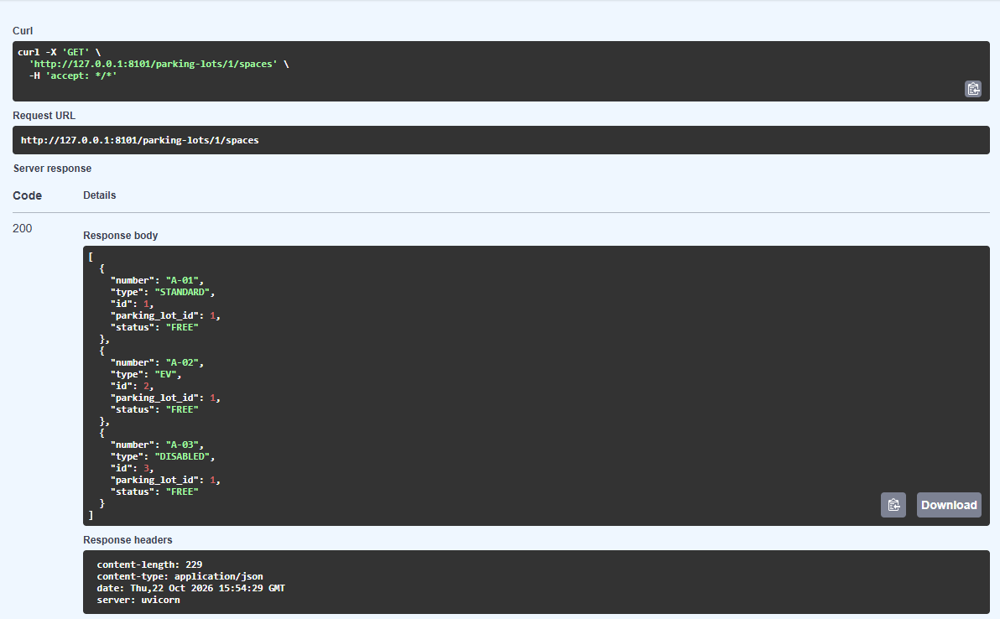
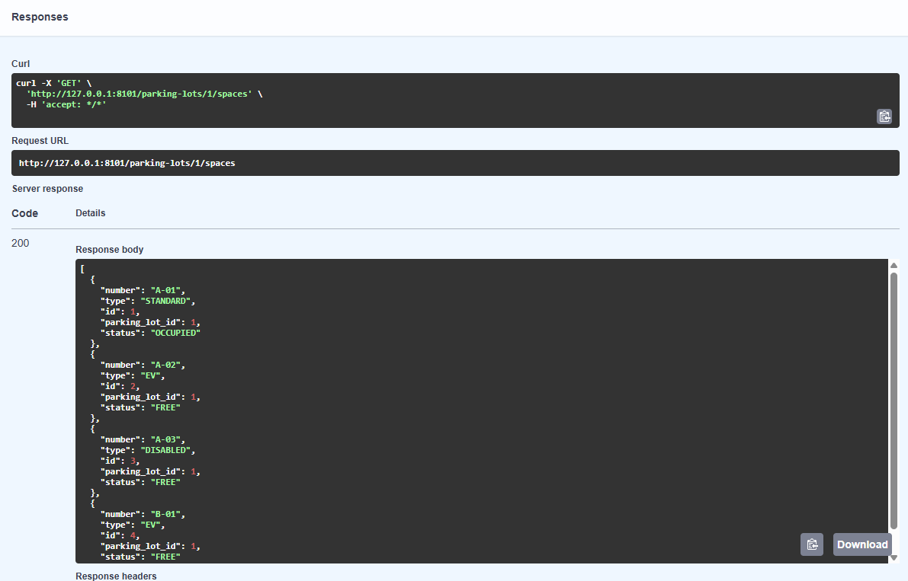
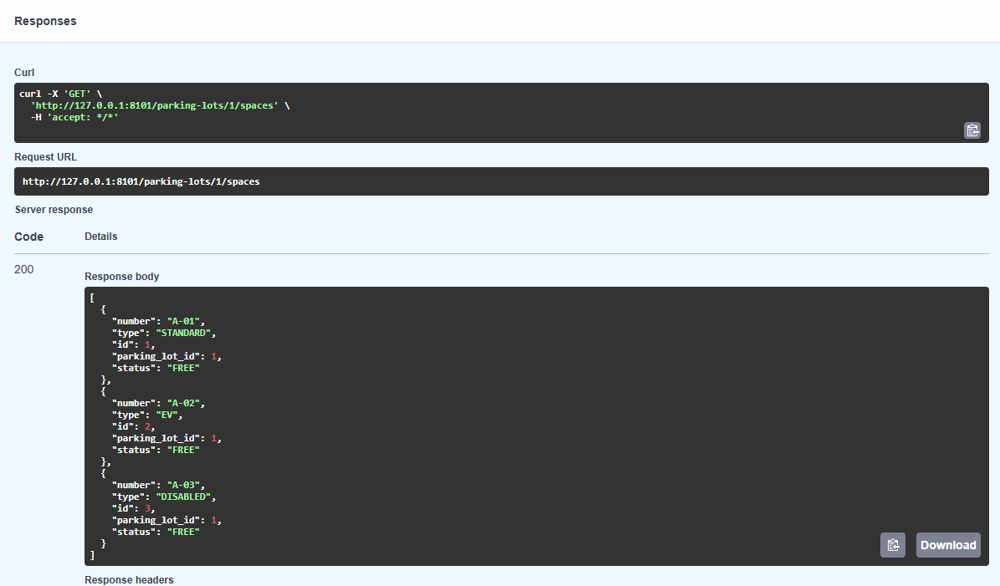

# Parkivo — Parking Reservation Service

Backendowy system zarządzania parkingiem oparty na mikrousługach.
Główny cel: pokazać jeden proces biznesowy realizowany przez współpracujące usługi — od rezerwacji miejsca, przez sesję parkowania, po rozliczenie.

## Spis treści

1. [Docelowy system](#1-docelowy-system)
2. [Granica odpowiedzialności usług](#2-granica-odpowiedzialności-usług)
3. [Model danych](#3-model-danych-parking-service)
4. [API Parking Service](#4-api-parking-service)
5. [Implementacja LAB1](#5-implementacja-lab1)
6. [Stos technologiczny i struktura repozytorium](#6-stos-technologiczny-i-struktura-repozytorium)

---

## 1. Docelowy system

| # | Usługa | Odpowiada za | Osoba |
|---|--------|--------------|-------|
| 1 | **Parking Service** | parkingi, miejsca, ich statusy | 1 |
| 2 | **Reservation Service** | rezerwacje miejsc na przedział czasu | 1 |
| 3 | **Parking Session Service** | wjazd/wyjazd pojazdów, sesje postoju | 2 |
| 4 | **Billing Service** | cennik, rachunki, płatności | 2 |

Przepływ biznesowy:

1. Użytkownik rezerwuje miejsce A-12 (Reservation Service).
2. Miejsce dostaje status zarezerwowanego (Parking Service).
3. Wjazd pojazdu rozpoczyna sesję, wyjazd ją kończy (Parking Session Service).
4. System oblicza opłatę i tworzy rachunek (Billing Service).
5. Po potwierdzeniu płatności miejsce zostaje zwolnione.

---

## 2. Granica odpowiedzialności usług

### Parking Service (implementowana na LAB1)

**Usługa odpowiada za:**
- prowadzenie rejestru parkingów i miejsc parkingowych (dodawanie, odczyt, edycja),
- typy miejsc (standardowe, dla osób z niepełnosprawnościami, EV),
- **aktualny status każdego miejsca** i pilnowanie dozwolonych przejść między statusami,
- wyszukiwanie miejsc według parkingu, statusu i typu (np. wolne miejsca EV).

**Usługa nie odpowiada za:**
- rezerwacje, ich przedziały czasu i kolizje terminów (Reservation Service),
- wjazdy, wyjazdy i czas postoju pojazdów (Parking Session Service),
- ceny, rachunki i płatności (Billing Service).

### Podział usług

| Usługa | Odpowiedzialność biznesowa | Własne dane | Operacje | Informacje potrzebne od innej usługi |
|--------|---------------------------|-------------|----------|--------------------------------------|
| **Pierwsza — Parking Service** (LAB1) | Co fizycznie istnieje na parkingu i w jakim stanie jest każde miejsce | `parking_lots`, `parking_spaces` (w tym status miejsca) | tworzenie/odczyt parkingów, dodawanie miejsc, odczyt i filtrowanie miejsc, zmiana statusu miejsca, `/health` | **brak** — usługa działa samodzielnie; to inni pytają ją o miejsca |
| **Druga — Reservation Service** (planowana) | Kto i kiedy zarezerwował miejsce; brak nakładających się rezerwacji tego samego miejsca | `reservations` (id, space_id, user_id, starts_at, ends_at, status) | utworzenie, odczyt, anulowanie rezerwacji, wygasanie niepotwierdzonych | od Parking Service: czy miejsce istnieje i nie jest `OUT_OF_SERVICE`; zmiana statusu miejsca na `RESERVED` / `FREE` |

### Pojęcia domeny

| Pojęcie | Definicja | Kto może zmieniać |
|---------|-----------|-------------------|
| **Parking (ParkingLot)** | Obiekt o nazwie, adresie i pojemności, który grupuje miejsca. | Parking Service (administrator parkingu) |
| **Miejsce (ParkingSpace)** | Pojedyncze, ponumerowane (np. A-12) miejsce na parkingu, o określonym typie. | Parking Service (administrator parkingu) |
| **Status miejsca** | Aktualny stan miejsca: `FREE`, `RESERVED`, `OCCUPIED`, `OUT_OF_SERVICE`. | Parking Service przyjmuje zmianę; inicjują ją: Reservation Service (`RESERVED`/`FREE`), Parking Session Service (`OCCUPIED`/`FREE`), administrator (`OUT_OF_SERVICE`) |
| **Typ miejsca** | Rodzaj miejsca: `STANDARD`, `DISABLED`, `EV`. | tylko Parking Service (przy tworzeniu miejsca) |
| **Rezerwacja** | Prawo użytkownika do miejsca w przedziale czasu — *nie* jest to status miejsca. | tylko Reservation Service |

### Dlaczego taki podział?

Granice wynikają z **odpowiedzialności biznesowej**, a nie z tabel w bazie. Parking Service odpowiada na pytanie *„jakie miejsca są i w jakim są stanie?”*, a Reservation Service na pytanie *„kto może z nich skorzystać i kiedy?”*. Te dwie rzeczy zmieniają się z innych powodów i w innym tempie: cennik czy zasady rezerwacji (np. wygasanie po 15 minutach) nie powinny wymuszać zmian w rejestrze miejsc. Gdyby podział robić po tabelach, powstałaby osobna usługa dla każdej encji (np. „usługa typów miejsc”), co nie ma sensu biznesowego — `ParkingLot` i `ParkingSpace` żyją razem w jednym kontekście (bounded context), bo miejsce nie istnieje bez parkingu, a spójność pojemności i numeracji trzeba pilnować w jednym miejscu.

### Kontrakt przyszłego wywołania HTTP

**Reservation Service → Parking Service**: po utworzeniu rezerwacji oznacz miejsce jako zarezerwowane.

- **Nadawca:** Reservation Service
- **Odbiorca:** Parking Service
- **Metoda i ścieżka:** `PATCH /spaces/{id}/status`

Żądanie:

```http
PATCH /spaces/12/status HTTP/1.1
Content-Type: application/json

{ "status": "RESERVED" }
```

Odpowiedź `200 OK`:

```json
{ "id": 12, "parking_lot_id": 1, "number": "A-12", "type": "STANDARD", "status": "RESERVED" }
```

Odpowiedzi błędów: `404` (miejsce nie istnieje), `409` (miejsce jest już `RESERVED`/`OCCUPIED`/`OUT_OF_SERVICE`), `422` (niepoprawny status).

**Zachowanie przy niedostępności odbiorcy** (timeout, błąd połączenia, `5xx`):

- Reservation Service ustawia timeout 2 s i ponawia żądanie maks. 2 razy (backoff 0,5 s).
- Jeśli nadal brak odpowiedzi — **nie zapisuje rezerwacji** i zwraca klientowi `503 Service Unavailable` z `{"detail": "Parking Service niedostępny"}`. Dzięki temu nie powstaje rezerwacja miejsca, które nie zostało zablokowane.
- `409` od Parking Service oznacza „miejsce zajęte” i jest przekazywane klientowi jako `409`.

### Trzy warianty architektury

**Wariant A — aplikacja monolityczna**

```
Klient
  |
  v
Jedna aplikacja
├── obsługa parkingów i miejsc
├── obsługa rezerwacji
├── sesje parkowania
└── rozliczenia
  |
  v
Jedna baza danych
```

Wszystkie funkcje działają w jednym procesie. Wywołanie odbywa się bezpośrednio w kodzie (np. moduł rezerwacji wywołuje metodę zmiany statusu miejsca).

**Wariant B — modularny monolit**

```
Klient
  |
  v
Jedna aplikacja i jeden proces
├── moduł parkingów
├── moduł rezerwacji
├── moduł sesji
└── moduł rozliczeń
  |
  v
Jedna baza danych
```

Moduły mają wyraźne granice i osobny kod, ale są uruchamiane i wdrażane razem. Komunikacja odbywa się wewnątrz procesu („wywołanie w kodzie”).

**Wariant C — mikrousługi**

```
Klient
  |
  +--> Parking Service     --> Parking DB
  +--> Reservation Service --> Reservation DB
  +--> Session Service     --> Session DB
  +--> Billing Service     --> Billing DB
```

Każda usługa to osobny proces z własną bazą; usługi wołają się nawzajem przez HTTP (np. Reservation Service → Parking Service).

### Checkpoint przed kodowaniem

- **Zakres pierwszej usługi:** rejestr parkingów i miejsc oraz ich statusów.
- **Rola drugiej:** Reservation Service rezerwuje miejsca na czas i prosi Parking Service o zmianę statusu.
- **Reguła pierwszej usługi:** miejsca zajętego (`OCCUPIED`) nie można zarezerwować; dozwolone są tylko określone przejścia statusów (patrz [sekcja 3](#reguła-biznesowa-przejścia-statusów-miejsca)).

---

## 3. Model danych (Parking Service)

### ParkingLot

| Pole | Typ | Wymagane | Opis |
|------|-----|----------|------|
| `id` | int | nadaje **serwer** | klucz główny, autoinkrementacja |
| `name` | string (1–100) | tak | nazwa, unikalna |
| `address` | string (1–200) | tak | adres |

### ParkingSpace

| Pole | Typ | Wymagane | Opis |
|------|-----|----------|------|
| `id` | int | nadaje **serwer** | klucz główny |
| `parking_lot_id` | int | tak (z ścieżki) | parking, do którego należy miejsce |
| `number` | string (1–10) | tak | np. `A-12`, unikalny w obrębie parkingu |
| `type` | enum | nie (domyślnie `STANDARD`) | `STANDARD`, `DISABLED`, `EV` |
| `status` | enum | nie (domyślnie `FREE` przy tworzeniu) | `FREE`, `RESERVED`, `OCCUPIED`, `OUT_OF_SERVICE` |

Decyzje projektowe:

- **Identyfikator nadaje serwer** — klient nie może wybrać cudzego ani kolidującego id.
- **Dwa modele**, bo parking i miejsce mają różny cykl życia: parking zmienia się rzadko, status miejsca często.
- Status przy tworzeniu miejsca zawsze `FREE`; klient nie może utworzyć miejsca od razu jako `OCCUPIED`.

### Reguła biznesowa: przejścia statusów miejsca

Status zmienia się tylko według poniższej tabeli (dotyczy wyłącznie danych Parking Service, więc da się ją sprawdzić bez drugiej usługi):

| Z \ Na | FREE | RESERVED | OCCUPIED | OUT_OF_SERVICE |
|--------|:----:|:--------:|:--------:|:--------------:|
| **FREE** | — | ✅ | ✅ | ✅ |
| **RESERVED** | ✅ | — | ✅ | ✅ |
| **OCCUPIED** | ✅ | ❌ | — | ✅ |
| **OUT_OF_SERVICE** | ✅ | ❌ | ❌ | — |

Dodatkowo: ustawienie tego samego statusu, który miejsce już ma, jest konfliktem.

- **Dozwolone:** miejsce `FREE` → `RESERVED` (`PATCH /spaces/12/status` z `{"status": "RESERVED"}`) → `200`.
- **Niedozwolone:** miejsce `OCCUPIED` → `RESERVED` albo `OUT_OF_SERVICE` → `OCCUPIED` → **`409 Conflict`**
  `{"detail": "Niedozwolona zmiana statusu: OCCUPIED -> RESERVED"}`.
- **Niepoprawna wartość** statusu (np. `"BROKEN"`) → `422`.

---

## 4. API Parking Service

Konwencje:

- Format: JSON, daty (jeśli występują) w ISO 8601 UTC.
- `404` — nieistniejący zasób, `409` — konflikt z aktualnym stanem, `422` — niepoprawne dane.
- Pusta lista to `200` i `[]`; brak pojedynczego elementu to `404`.

### Tabela operacji

| Metoda | Endpoint | Znaczenie | Sukces | Błędy |
|--------|----------|-----------|--------|-------|
| GET | `/health` | status działania usługi | 200 | — |
| GET | `/parking-lots` | lista parkingów | 200 | — |
| POST | `/parking-lots` | utworzenie parkingu | 201 | 409, 422 |
| GET | `/parking-lots/{id}` | jeden parking | 200 | 404, 422 |
| GET | `/parking-lots/{id}/spaces` | lista miejsc parkingu (filtry `status`, `type`) | 200 | 404, 422 |
| POST | `/parking-lots/{id}/spaces` | dodanie miejsca | 201 | 404, 409, 422 |
| GET | `/spaces/{id}` | jedno miejsce | 200 | 404, 422 |
| PATCH | `/spaces/{id}/status` | zmiana statusu miejsca | 200 | 404, 409, 422 |

### Format błędów

Zachowujemy standardowy format FastAPI.

**`HTTPException` (404, 409)** — jeden opis tekstowy:

```json
{ "detail": "Parking lot 99 not found" }
```

**Walidacja (422)** — lista szczegółów w `detail`:

```json
{
  "detail": [
    {
      "type": "string_too_short",
      "loc": ["body", "name"],
      "msg": "String should have at least 1 character",
      "input": ""
    }
  ]
}
```

### GET /health

Bez danych domenowych.

`200`:

```json
{ "status": "ok", "service": "parking-service" }
```

### GET /parking-lots

`200` — lista (może być pusta `[]`):

```json
[
  { "id": 1, "name": "Parking Centrum", "address": "ul. Długa 1, Gdańsk" }
]
```

### POST /parking-lots

Żądanie:

| Pole | Typ | Wymagane | Ograniczenia |
|------|-----|----------|--------------|
| `name` | string | tak | 1–100 znaków, unikalna |
| `address` | string | tak | 1–200 znaków |

```json
{ "name": "Parking Centrum", "address": "ul. Długa 1, Gdańsk" }
```

`201 Created`:

```json
{ "id": 1, "name": "Parking Centrum", "address": "ul. Długa 1, Gdańsk" }
```

Błędy: `409` `{"detail": "Parking lot with name 'Parking Centrum' already exists"}`; `422` (brak lub pusta nazwa/adres).

### GET /parking-lots/{id}

Parametr ścieżki: `id` (int).

`200`:

```json
{ "id": 1, "name": "Parking Centrum", "address": "ul. Długa 1, Gdańsk" }
```

Błędy: `404` `{"detail": "Parking lot 99 not found"}`; `422` (`id` nie jest liczbą).

### GET /parking-lots/{id}/spaces

Parametry zapytania (opcjonalne): `status` (`FREE|RESERVED|OCCUPIED|OUT_OF_SERVICE`), `type` (`STANDARD|DISABLED|EV`).

Przykład: `GET /parking-lots/1/spaces?status=FREE&type=EV`

`200` (parking istnieje, ale nic nie pasuje → `[]`):

```json
[
  { "id": 3, "parking_lot_id": 1, "number": "A-03", "type": "EV", "status": "FREE" }
]
```

Błędy: `404` (parking nie istnieje); `422` (niepoprawna wartość filtra).

### POST /parking-lots/{id}/spaces

Żądanie:

| Pole | Typ | Wymagane | Ograniczenia |
|------|-----|----------|--------------|
| `number` | string | tak | 1–10 znaków, unikalny w parkingu |
| `type` | enum | nie | `STANDARD` (domyślnie), `DISABLED`, `EV` |

```json
{ "number": "A-12", "type": "STANDARD" }
```

`201 Created` (status zawsze `FREE`):

```json
{ "id": 12, "parking_lot_id": 1, "number": "A-12", "type": "STANDARD", "status": "FREE" }
```

Błędy: `404` (parking nie istnieje); `409` `{"detail": "Space A-12 already exists in parking lot 1"}`; `422`.

### GET /spaces/{id}

`200`:

```json
{ "id": 12, "parking_lot_id": 1, "number": "A-12", "type": "STANDARD", "status": "FREE" }
```

Błędy: `404` `{"detail": "Space 99 not found"}`; `422`.

### PATCH /spaces/{id}/status

Żądanie:

| Pole | Typ | Wymagane | Ograniczenia |
|------|-----|----------|--------------|
| `status` | enum | tak | `FREE`, `RESERVED`, `OCCUPIED`, `OUT_OF_SERVICE` |

```json
{ "status": "RESERVED" }
```

`200`:

```json
{ "id": 12, "parking_lot_id": 1, "number": "A-12", "type": "STANDARD", "status": "RESERVED" }
```

Błędy:

- `404` `{"detail": "Space 99 not found"}`
- `409` `{"detail": "Niedozwolona zmiana statusu: OCCUPIED -> RESERVED"}` (reguła z sekcji 3; także ten sam status co aktualny)
- `422` (np. `{"status": "BROKEN"}` lub brak pola `status`)

---

## 5. Implementacja LAB1

Zaimplementowana jest tylko pierwsza usługa — **Parking Service** (FastAPI). Pozostałe usługi są wyłącznie zaprojektowane.

### Uruchomienie

```bash
python -m venv .venv
.venv\Scripts\activate            # Windows
pip install -r requirements.txt
python -m uvicorn app.main:app --reload --port 8101
```

Swagger UI: `http://127.0.0.1:8101/docs`. Testy: `python -m pytest`.

### Struktura kodu

```
app/
  main.py      # create_app(), endpointy, tabela dozwolonych przejść statusów
  models.py    # modele Pydantic i enumy (SpaceStatus, SpaceType)
  store.py     # magazyn w pamięci (Store) i dane początkowe (seed)
tests/
  conftest.py        # fixture client (świeża aplikacja z create_app())
  test_health.py     # test /health
  test_parking.py    # testy domenowe: odczyt, zapis, 404, 422, 409, reguła przejść
requirements.txt
```

### Przechowywanie danych i ograniczenia

- Dane są w **słownikach w pamięci procesu** (`Store.lots`, `Store.spaces`). Na LAB1 nie ma bazy danych, pliku ani cache.
- Magazyn jest tworzony **raz na instancję aplikacji** w `create_app()` i zapisany w `app.state.store`; endpointy dostają go przez `Depends(get_store)`. Zmiana z `POST`/`PATCH` jest więc widoczna w następnym `GET`.
- Każde wywołanie `create_app()` daje **własny, nowy magazyn** — dzięki temu testy zaczynają od znanego stanu.
- **Restart procesu** (także ten wywołany przez `--reload`) usuwa wszystkie zmiany z pamięci i przywraca dane początkowe.
- **Dwie instancje** uruchomione na różnych portach mają **osobne magazyny** i osobne liczniki `id`.
- Identyfikatory nadaje serwer (osobne liczniki dla parkingów i miejsc), więc po restarcie numeracja zaczyna się od nowa.

### Dane początkowe (seed)

Po starcie aplikacja zawiera:

| Zasób | id | Dane |
|-------|----|------|
| Parking | 1 | `Parking Szpital`, `ul. lwowska 60` |
| Miejsce | 1 | `A-01`, `STANDARD`, `FREE` |
| Miejsce | 2 | `A-02`, `EV`, `FREE` |
| Miejsce | 3 | `A-03`, `DISABLED`, `FREE` |

### Kody odpowiedzi — dlaczego takie

| Kod | Kiedy | Uzasadnienie |
|-----|-------|--------------|
| `200 OK` | odczyt lub zmiana statusu istniejącego miejsca | operacja się udała, nie powstał nowy zasób |
| `201 Created` | `POST` parkingu lub miejsca | w wyniku operacji powstał nowy zasób z `id` nadanym przez serwer |
| `404 Not Found` | parking lub miejsce o podanym `id` nie istnieje | adres wskazuje zasób, którego nie ma; pusta lista to jednak `200` i `[]`, bo kolekcja istnieje |
| `409 Conflict` | duplikat nazwy parkingu, duplikat numeru miejsca w parkingu, niedozwolone przejście statusu | dane są poprawne same w sobie, ale **kolidują z aktualnym stanem** — to samo żądanie w innym stanie mogłoby się udać |
| `422 Unprocessable Entity` | pusta nazwa, za długi `number`, status spoza listy, `id` niebędące liczbą | żądanie jest zrozumiałe, ale **dane są niepoprawne niezależnie od stanu**; sprawdza je Pydantic, zanim kod dotknie magazynu |

Reguła przejść statusów daje `409`, a nie `422`, ponieważ `{"status": "RESERVED"}` jest poprawnym żądaniem: jego odrzucenie zależy od aktualnego statusu miejsca (`FREE → RESERVED` przejdzie, `OCCUPIED → RESERVED` nie).

Wszystkie warunki odrzucenia (`404`, `409`) są sprawdzane **przed** zmianą danych, więc odrzucone żądanie nie zostawia częściowo zmienionego stanu.

### Testy automatyczne

Uruchomienie: `python -m pytest` (nie wymaga działającego Uvicorna — używany jest `TestClient`).

Fixture `client` w `tests/conftest.py` tworzy **świeżą aplikację przez `create_app()`**, więc każdy test startuje od danych początkowych z sekcji „Dane początkowe (seed)” i nie zależy od kolejności uruchomienia.

| Scenariusz | Testy (`tests/test_parking.py`) |
|------------|---------------------------------|
| `/health` | `test_health` (`tests/test_health.py`) |
| Lista i szczegóły | `test_list_and_detail_of_seeded_lot`, `test_list_spaces_filters_and_empty_list` (w tym `200` i `[]`) |
| Zapis → odczyt | `test_create_space_then_read_it_back`, `test_create_lot_then_read_it_back` |
| Brak zasobu (`404`) | `test_missing_resources_return_404` |
| Niepoprawne dane (`422`), brak zmiany stanu | `test_invalid_data_returns_422_and_changes_nothing` |
| Konflikt (`409`), brak zmiany stanu | `test_duplicate_lot_name_returns_409_and_changes_nothing`, `test_duplicate_space_number_returns_409_and_changes_nothing` |
| Reguła biznesowa (przejścia statusów) | `test_allowed_status_transition_is_visible_in_next_get`, `test_occupied_space_cannot_be_reserved`, `test_out_of_service_space_must_return_to_free_first`, `test_setting_the_same_status_is_a_conflict` |
| Izolacja testów | `test_each_test_starts_from_seed_state` |

Testy sprawdzają kod HTTP oraz istotne pola JSON. Testy odrzuceń (`422`, `409`) dodatkowo potwierdzają osobnym `GET`, że stan magazynu się nie zmienił.

Restart procesu i prawdziwy port są sprawdzane osobno, ręcznie (`TestClient` nie uruchamia Uvicorna).

### Eksperyment z restartem

**Cel:** pokazać, że dane przetrwają między żądaniami, ale nie między uruchomieniami procesu.

**Przygotowanie:** serwer uruchomiony bez `--reload`, żeby restart był wyłącznie moją decyzją, i bez zmian w kodzie w trakcie eksperymentu:

```bash
.venv\Scripts\python.exe -m uvicorn app.main:app --port 8101
```

Wszystkie żądania wykonane w Swagger UI (`http://127.0.0.1:8101/docs`, „Try it out”).

| Krok | Żądanie | Oczekiwany wynik | Wynik rzeczywisty |
|------|---------|------------------|-------------------|
| 1. Stan początkowy | `GET /parking-lots/1/spaces` | `200`, 3 miejsca (`A-01`, `A-02`, `A-03`), wszystkie `FREE` | zgodny z oczekiwaniem — [zrzut 1](#zrzut-1) |
| 2. Zmiana danych | `POST /parking-lots/1/spaces` z `{"number": "B-01", "type": "EV"}`, potem `PATCH /spaces/1/status` z `{"status": "OCCUPIED"}` | nowe miejsce `B-01` (`id=4`, `FREE`) i `A-01` jako `OCCUPIED` | potwierdzone w kroku 3 |
| 3. Potwierdzenie osobnym `GET` | `GET /parking-lots/1/spaces` | `200`, 4 miejsca, `A-01` = `OCCUPIED`, jest `B-01` | zgodny z oczekiwaniem — [zrzut 2](#zrzut-2) |
| 4. Restart | Ctrl+C w terminalu z serwerem, ponowne uruchomienie tą samą komendą | serwer startuje od nowa | — |
| 5. Powtórzenie `GET` | `GET /parking-lots/1/spaces` | `200`, znów 3 miejsca, `A-01` = `FREE`, brak `B-01` | zgodny z oczekiwaniem — [zrzut 3](#zrzut-3) |

**Przywrócenie stanu:** nie jest potrzebne — restart procesu sam przywraca dane początkowe (seed).

<a id="zrzut-1"></a>**Zrzut 1 — stan początkowy (3 miejsca, wszystkie `FREE`)**



<a id="zrzut-2"></a>**Zrzut 2 — po zmianie (`A-01` = `OCCUPIED`, dodane `B-01`)**



<a id="zrzut-3"></a>**Zrzut 3 — po restarcie (stan jak na początku)**



**Wyjaśnienie:**

- Dane **przetrwały między żądaniami**, ponieważ magazyn `Store` jest tworzony **raz** w `create_app()` i zapisany w `app.state.store`. Każde żądanie czyta i zapisuje te same słowniki w pamięci działającego procesu, więc osobny `GET` widzi zmianę z `POST`/`PATCH`.
- Dane **nie przetrwały restartu**, ponieważ słowniki żyją wyłącznie w pamięci procesu. Ctrl+C kończy proces i system zwalnia jego pamięć. Nowy proces wywołuje `create_app()` od początku, tworzy pusty `Store` i ładuje dane początkowe (`seed`), więc `A-01` wraca do `FREE`, a `B-01` znika. Na LAB1 jest to zamierzone ograniczenie: nie ma bazy danych ani zapisu do pliku.

### Praca z dokumentacją (EK_03)

#### Fragment 1 — model żądania (Request Body)

Dokumentacja: <https://fastapi.tiangolo.com/tutorial/body/>

**Problem:** sprawdzić dane wejściowe (pusta nazwa, za długi numer, nieznany status) i nie pozwolić klientowi podawać `id`.
**Rozwiązanie:** ciało żądania to parametr funkcji typu modelu Pydantic; FastAPI waliduje je przed wejściem do funkcji.

`app/models.py`:

```python
class ParkingLotCreate(BaseModel):
    name: str = Field(min_length=1, max_length=100)
    address: str = Field(min_length=1, max_length=200)

class ParkingLot(ParkingLotCreate):
    id: int
```

`app/main.py`:

```python
@app.post("/parking-lots", response_model=ParkingLot, status_code=201)
def create_lot(data: ParkingLotCreate, store: Store = Depends(get_store)):
    ...
    return store.add_lot(data)
```

`app/store.py` (`model_dump()` z dokumentacji):

```python
lot = ParkingLot(id=self.next_lot_id, **data.model_dump())
```

**Sprawdzenie:** `POST /parking-lots` z pustą nazwą daje `422`, a lista parkingów się nie zmienia (`test_invalid_data_returns_422_and_changes_nothing`); poprawny `POST` daje `201`, a osobny `GET` potwierdza zapis (`test_create_lot_then_read_it_back`).

#### Fragment 2 — obsługa błędów (Handling Errors)

Dokumentacja: <https://fastapi.tiangolo.com/tutorial/handling-errors/>

**Problem:** odróżnić brak zasobu (`404`) od konfliktu ze stanem (`409`) i przerwać operację, zanim zmieni dane.
**Rozwiązanie:** `raise HTTPException(status_code=..., detail=...)` — wyjątek się rzuca, a nie zwraca, więc kończy funkcję natychmiast.

`app/main.py`:

```python
space = store.get_space(space_id)
if space is None:
    raise HTTPException(status_code=404, detail=f"Space {space_id} not found")
if body.status not in ALLOWED_TRANSITIONS[space.status]:
    raise HTTPException(
        status_code=409,
        detail=f"Niedozwolona zmiana statusu: {space.status.value} -> {body.status.value}",
    )
space.status = body.status
```

**Sprawdzenie:** `GET /spaces/99` daje `404` z `{"detail": "Space 99 not found"}` (`test_missing_resources_return_404`); `OCCUPIED → RESERVED` daje `409`, a następny `GET` pokazuje nadal `OCCUPIED` (`test_occupied_space_cannot_be_reserved`).

## 6. Stos technologiczny i struktura repozytorium

| Element | Technologia |
|---------|-------------|
| Mikrousługi | Python + FastAPI |
| Walidacja | Pydantic |
| Baza danych | PostgreSQL (osobna baza/schemat dla usługi) |
| ORM | SQLAlchemy |
| Komunikacja | REST API; RabbitMQ dla zdarzeń (`VehicleEntered`, `ParkingSessionEnded`, `PaymentConfirmed`) — w późniejszych etapach |
| Uruchamianie | Docker + Docker Compose |
| Testy | pytest + httpx |
| Dokumentacja | Swagger UI / OpenAPI (`/docs`) |

Planowana struktura docelowa (na LAB1 istnieje tylko kod Parking Service w `app/`):

```
parkivo/
  services/
    parking-service/
    reservation-service/
    parking-session-service/
    billing-service/
  docker-compose.yml
  docs/
  tests/
  README.md
```
