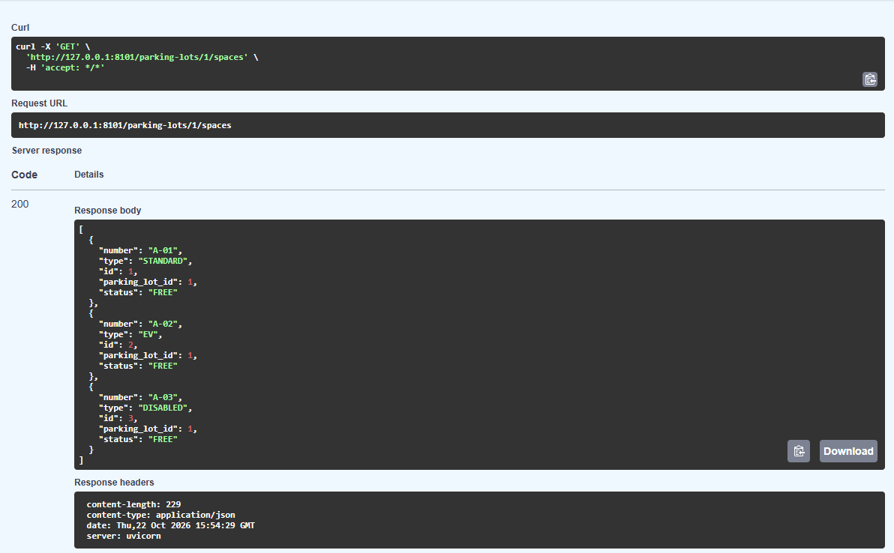
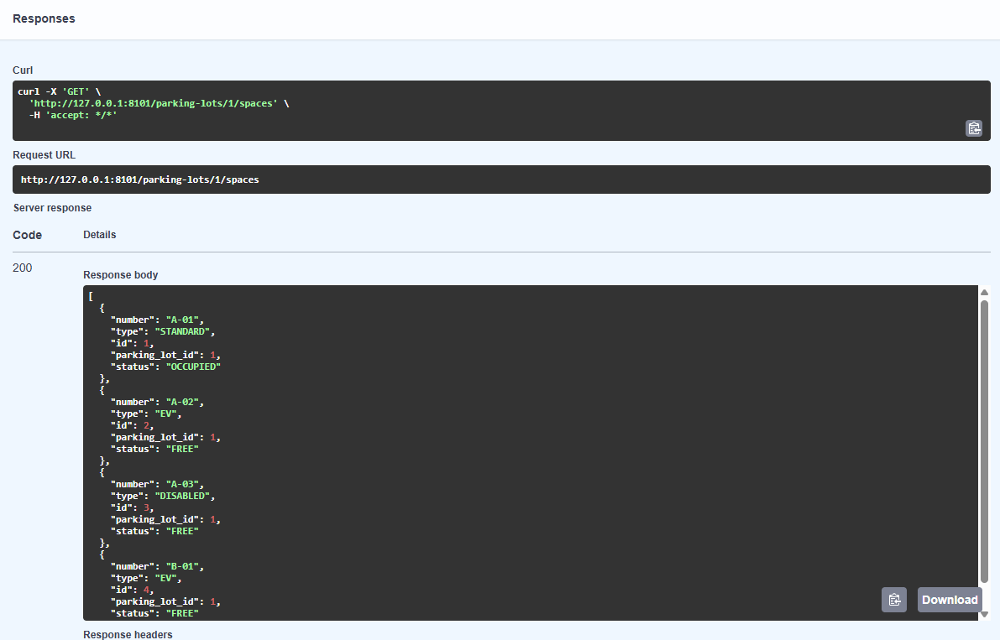
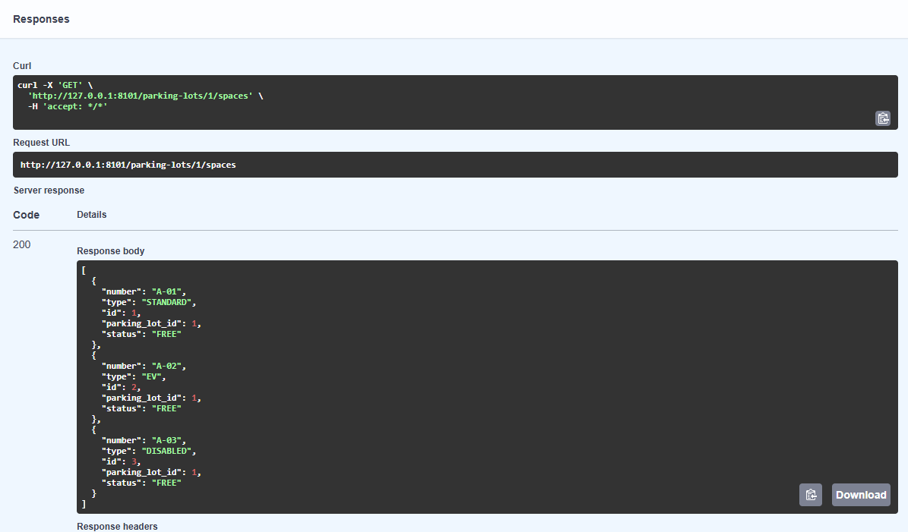
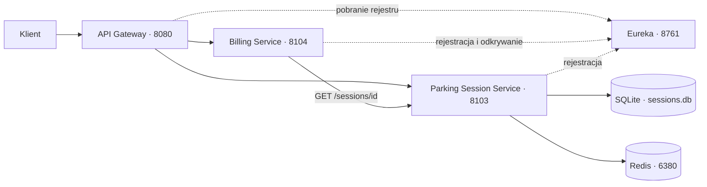

# Parkivo — Parking Reservation Service

Backendowy system zarządzania parkingiem oparty na mikrousługach.
Główny cel: pokazać jeden proces biznesowy realizowany przez współpracujące usługi — od rezerwacji miejsca, przez sesję parkowania, po rozliczenie.

## Spis treści

1. [Docelowy system](#system)
2. [Granica odpowiedzialności usług](#granice-uslug)
3. [Model danych](#parking-model)
4. [API Parking Service](#parking-api)
5. [Parking Service — LAB1](#parking-lab1)
6. [Parking Service — LAB2 (baza i cache)](#parking-lab2)
7. [Stos technologiczny i struktura repozytorium](#struktura)
8. [Parking Session Service — LAB1](#session-lab1)
9. [Parking Session Service — LAB2](#session-lab2)
10. [Parking Session Service i Billing Service — LAB3](#billing-lab3)
11. [Bramka API dla sesji i wyceny — LAB4](#gateway-lab4)

---

<a id="system"></a>

## 1. Docelowy system

| # | Usługa | Odpowiada za | Osoba |
|---|--------|--------------|-------|
| 1 | **Parking Service** | parkingi, miejsca, ich statusy | 1 |
| 2 | **Reservation Service** | rezerwacje miejsc na przedział czasu | 1 |
| 3 | **Parking Session Service** | wjazd/wyjazd pojazdów, sesje postoju | 2 |
| 4 | **Billing Service** | cennik, rachunki, płatności | 2 |

Przepływ biznesowy:

1. Użytkownik rezerwuje miejsce A-12 (Reservation Service).
2. Miejsce dostaje status zarezerwowanego (Parking Service).
3. Wjazd pojazdu rozpoczyna sesję, wyjazd ją kończy (Parking Session Service).
4. System oblicza opłatę i tworzy rachunek (Billing Service).
5. Po potwierdzeniu płatności miejsce zostaje zwolnione.

---

<a id="granice-uslug"></a>

## 2. Granica odpowiedzialności usług

### Parking Service (implementowana na LAB1)

**Usługa odpowiada za:**
- prowadzenie rejestru parkingów i miejsc parkingowych (dodawanie, odczyt, edycja),
- typy miejsc (standardowe, dla osób z niepełnosprawnościami, EV),
- **aktualny status każdego miejsca** i pilnowanie dozwolonych przejść między statusami,
- wyszukiwanie miejsc według parkingu, statusu i typu (np. wolne miejsca EV).

**Usługa nie odpowiada za:**
- rezerwacje, ich przedziały czasu i kolizje terminów (Reservation Service),
- wjazdy, wyjazdy i czas postoju pojazdów (Parking Session Service),
- ceny, rachunki i płatności (Billing Service).

### Podział usług

| Usługa | Odpowiedzialność biznesowa | Własne dane | Operacje | Informacje potrzebne od innej usługi |
|--------|---------------------------|-------------|----------|--------------------------------------|
| **Pierwsza — Parking Service** (LAB1) | Co fizycznie istnieje na parkingu i w jakim stanie jest każde miejsce | `parking_lots`, `parking_spaces` (w tym status miejsca) | tworzenie/odczyt parkingów, dodawanie miejsc, odczyt i filtrowanie miejsc, zmiana statusu miejsca, `/health` | **brak** — usługa działa samodzielnie; to inni pytają ją o miejsca |
| **Druga — Reservation Service** (planowana) | Kto i kiedy zarezerwował miejsce; brak nakładających się rezerwacji tego samego miejsca | `reservations` (id, space_id, user_id, starts_at, ends_at, status) | utworzenie, odczyt, anulowanie rezerwacji, wygasanie niepotwierdzonych | od Parking Service: czy miejsce istnieje i nie jest `OUT_OF_SERVICE`; zmiana statusu miejsca na `RESERVED` / `FREE` |

### Pojęcia domeny

| Pojęcie | Definicja | Kto może zmieniać |
|---------|-----------|-------------------|
| **Parking (ParkingLot)** | Obiekt o nazwie, adresie i pojemności, który grupuje miejsca. | Parking Service (administrator parkingu) |
| **Miejsce (ParkingSpace)** | Pojedyncze, ponumerowane (np. A-12) miejsce na parkingu, o określonym typie. | Parking Service (administrator parkingu) |
| **Status miejsca** | Aktualny stan miejsca: `FREE`, `RESERVED`, `OCCUPIED`, `OUT_OF_SERVICE`. | Parking Service przyjmuje zmianę; inicjują ją: Reservation Service (`RESERVED`/`FREE`), Parking Session Service (`OCCUPIED`/`FREE`), administrator (`OUT_OF_SERVICE`) |
| **Typ miejsca** | Rodzaj miejsca: `STANDARD`, `DISABLED`, `EV`. | tylko Parking Service (przy tworzeniu miejsca) |
| **Rezerwacja** | Prawo użytkownika do miejsca w przedziale czasu — *nie* jest to status miejsca. | tylko Reservation Service |

### Dlaczego taki podział?

Granice wynikają z **odpowiedzialności biznesowej**, a nie z tabel w bazie. Parking Service odpowiada na pytanie *„jakie miejsca są i w jakim są stanie?”*, a Reservation Service na pytanie *„kto może z nich skorzystać i kiedy?”*. Te dwie rzeczy zmieniają się z innych powodów i w innym tempie: cennik czy zasady rezerwacji (np. wygasanie po 15 minutach) nie powinny wymuszać zmian w rejestrze miejsc. Gdyby podział robić po tabelach, powstałaby osobna usługa dla każdej encji (np. „usługa typów miejsc”), co nie ma sensu biznesowego — `ParkingLot` i `ParkingSpace` żyją razem w jednym kontekście (bounded context), bo miejsce nie istnieje bez parkingu, a spójność pojemności i numeracji trzeba pilnować w jednym miejscu.

### Kontrakt przyszłego wywołania HTTP

**Reservation Service → Parking Service**: po utworzeniu rezerwacji oznacz miejsce jako zarezerwowane.

- **Nadawca:** Reservation Service
- **Odbiorca:** Parking Service
- **Metoda i ścieżka:** `PATCH /spaces/{id}/status`

Żądanie:

```http
PATCH /spaces/12/status HTTP/1.1
Content-Type: application/json

{ "status": "RESERVED" }
```

Odpowiedź `200 OK`:

```json
{ "id": 12, "parking_lot_id": 1, "number": "A-12", "type": "STANDARD", "status": "RESERVED" }
```

Odpowiedzi błędów: `404` (miejsce nie istnieje), `409` (miejsce jest już `RESERVED`/`OCCUPIED`/`OUT_OF_SERVICE`), `422` (niepoprawny status).

**Zachowanie przy niedostępności odbiorcy** (timeout, błąd połączenia, `5xx`):

- Reservation Service ustawia timeout 2 s i ponawia żądanie maks. 2 razy (backoff 0,5 s).
- Jeśli nadal brak odpowiedzi — **nie zapisuje rezerwacji** i zwraca klientowi `503 Service Unavailable` z `{"detail": "Parking Service niedostępny"}`. Dzięki temu nie powstaje rezerwacja miejsca, które nie zostało zablokowane.
- `409` od Parking Service oznacza „miejsce zajęte” i jest przekazywane klientowi jako `409`.

<a id="architektury"></a>

### Trzy warianty architektury

**Wariant A — aplikacja monolityczna**

```
Klient
  |
  v
Jedna aplikacja
├── obsługa parkingów i miejsc
├── obsługa rezerwacji
├── sesje parkowania
└── rozliczenia
  |
  v
Jedna baza danych
```

Wszystkie funkcje działają w jednym procesie. Wywołanie odbywa się bezpośrednio w kodzie (np. moduł rezerwacji wywołuje metodę zmiany statusu miejsca).

**Wariant B — modularny monolit**

```
Klient
  |
  v
Jedna aplikacja i jeden proces
├── moduł parkingów
├── moduł rezerwacji
├── moduł sesji
└── moduł rozliczeń
  |
  v
Jedna baza danych
```

Moduły mają wyraźne granice i osobny kod, ale są uruchamiane i wdrażane razem. Komunikacja odbywa się wewnątrz procesu („wywołanie w kodzie”).

**Wariant C — mikrousługi**

```
Klient
  |
  +--> Parking Service     --> Parking DB
  +--> Reservation Service --> Reservation DB
  +--> Session Service     --> Session DB
  +--> Billing Service     --> Billing DB
```

Każda usługa to osobny proces z własną bazą; usługi wołają się nawzajem przez HTTP (np. Reservation Service → Parking Service).

| Pytanie | Monolit | Modularny monolit | Mikrousługi |
|---|---|---|---|
| Wspólne wdrażanie wszystkich funkcji | Tak | Tak | Możliwe niezależne wdrożenia |
| Komunikacja komponentów | Funkcje w procesie | Interfejsy modułów w procesie | Sieć, np. HTTP |
| Procesy | Jeden | Jeden | Osobny dla każdej usługi |
| Awaria procesu | Obejmuje całą aplikację | Obejmuje całą aplikację | Dotyczy usługi i może wpłynąć na jej odbiorców |
| Własność danych | Wspólna aplikacja | Wyznaczona modułami | Wyznaczona usługami |

### Checkpoint przed kodowaniem

- **Zakres pierwszej usługi:** rejestr parkingów i miejsc oraz ich statusów.
- **Rola drugiej:** Reservation Service rezerwuje miejsca na czas i prosi Parking Service o zmianę statusu.
- **Reguła pierwszej usługi:** miejsca zajętego (`OCCUPIED`) nie można zarezerwować; dozwolone są tylko określone przejścia statusów (patrz [sekcja 3](#statusy-miejsc)).

---

<a id="parking-model"></a>

## 3. Model danych (Parking Service)

### ParkingLot

| Pole | Typ | Wymagane | Opis |
|------|-----|----------|------|
| `id` | int | nadaje **serwer** | klucz główny, autoinkrementacja |
| `name` | string (1–100) | tak | nazwa, unikalna |
| `address` | string (1–200) | tak | adres |

### ParkingSpace

| Pole | Typ | Wymagane | Opis |
|------|-----|----------|------|
| `id` | int | nadaje **serwer** | klucz główny |
| `parking_lot_id` | int | tak (z ścieżki) | parking, do którego należy miejsce |
| `number` | string (1–10) | tak | np. `A-12`, unikalny w obrębie parkingu |
| `type` | enum | nie (domyślnie `STANDARD`) | `STANDARD`, `DISABLED`, `EV` |
| `status` | enum | nie (domyślnie `FREE` przy tworzeniu) | `FREE`, `RESERVED`, `OCCUPIED`, `OUT_OF_SERVICE` |

Decyzje projektowe:

- **Identyfikator nadaje serwer** — klient nie może wybrać cudzego ani kolidującego id.
- **Dwa modele**, bo parking i miejsce mają różny cykl życia: parking zmienia się rzadko, status miejsca często.
- Status przy tworzeniu miejsca zawsze `FREE`; klient nie może utworzyć miejsca od razu jako `OCCUPIED`.

<a id="statusy-miejsc"></a>

### Reguła biznesowa: przejścia statusów miejsca

Status zmienia się tylko według poniższej tabeli (dotyczy wyłącznie danych Parking Service, więc da się ją sprawdzić bez drugiej usługi):

| Z \ Na | FREE | RESERVED | OCCUPIED | OUT_OF_SERVICE |
|--------|:----:|:--------:|:--------:|:--------------:|
| **FREE** | — | ✅ | ✅ | ✅ |
| **RESERVED** | ✅ | — | ✅ | ✅ |
| **OCCUPIED** | ✅ | ❌ | — | ✅ |
| **OUT_OF_SERVICE** | ✅ | ❌ | ❌ | — |

Dodatkowo: ustawienie tego samego statusu, który miejsce już ma, jest konfliktem.

- **Dozwolone:** miejsce `FREE` → `RESERVED` (`PATCH /spaces/12/status` z `{"status": "RESERVED"}`) → `200`.
- **Niedozwolone:** miejsce `OCCUPIED` → `RESERVED` albo `OUT_OF_SERVICE` → `OCCUPIED` → **`409 Conflict`**
  `{"detail": "Niedozwolona zmiana statusu: OCCUPIED -> RESERVED"}`.
- **Niepoprawna wartość** statusu (np. `"BROKEN"`) → `422`.

---

<a id="parking-api"></a>

## 4. API Parking Service

Konwencje:

- Format: JSON, daty (jeśli występują) w ISO 8601 UTC.
- `404` — nieistniejący zasób, `409` — konflikt z aktualnym stanem, `422` — niepoprawne dane.
- Pusta lista to `200` i `[]`; brak pojedynczego elementu to `404`.

### Tabela operacji

| Metoda | Endpoint | Znaczenie | Sukces | Błędy |
|--------|----------|-----------|--------|-------|
| GET | `/health` | status działania usługi | 200 | — |
| GET | `/parking-lots` | lista parkingów | 200 | — |
| POST | `/parking-lots` | utworzenie parkingu | 201 | 409, 422 |
| GET | `/parking-lots/{id}` | jeden parking | 200 | 404, 422 |
| GET | `/parking-lots/{id}/spaces` | lista miejsc parkingu (filtry `status`, `type`) | 200 | 404, 422 |
| POST | `/parking-lots/{id}/spaces` | dodanie miejsca | 201 | 404, 409, 422 |
| GET | `/spaces/{id}` | jedno miejsce | 200 | 404, 422 |
| PATCH | `/spaces/{id}/status` | zmiana statusu miejsca | 200 | 404, 409, 422 |

### Format błędów

Zachowujemy standardowy format FastAPI.

**`HTTPException` (404, 409)** — jeden opis tekstowy:

```json
{ "detail": "Parking lot 99 not found" }
```

**Walidacja (422)** — lista szczegółów w `detail`:

```json
{
  "detail": [
    {
      "type": "string_too_short",
      "loc": ["body", "name"],
      "msg": "String should have at least 1 character",
      "input": ""
    }
  ]
}
```

### GET /health

Bez danych domenowych.

`200`:

```json
{ "status": "ok", "service": "parking-service" }
```

### GET /parking-lots

`200` — lista (może być pusta `[]`):

```json
[
  { "id": 1, "name": "Parking Centrum", "address": "ul. Długa 1, Gdańsk" }
]
```

### POST /parking-lots

Żądanie:

| Pole | Typ | Wymagane | Ograniczenia |
|------|-----|----------|--------------|
| `name` | string | tak | 1–100 znaków, unikalna |
| `address` | string | tak | 1–200 znaków |

```json
{ "name": "Parking Centrum", "address": "ul. Długa 1, Gdańsk" }
```

`201 Created`:

```json
{ "id": 1, "name": "Parking Centrum", "address": "ul. Długa 1, Gdańsk" }
```

Błędy: `409` `{"detail": "Parking lot with name 'Parking Centrum' already exists"}`; `422` (brak lub pusta nazwa/adres).

### GET /parking-lots/{id}

Parametr ścieżki: `id` (int).

`200`:

```json
{ "id": 1, "name": "Parking Centrum", "address": "ul. Długa 1, Gdańsk" }
```

Błędy: `404` `{"detail": "Parking lot 99 not found"}`; `422` (`id` nie jest liczbą).

### GET /parking-lots/{id}/spaces

Parametry zapytania (opcjonalne): `status` (`FREE|RESERVED|OCCUPIED|OUT_OF_SERVICE`), `type` (`STANDARD|DISABLED|EV`).

Przykład: `GET /parking-lots/1/spaces?status=FREE&type=EV`

`200` (parking istnieje, ale nic nie pasuje → `[]`):

```json
[
  { "id": 3, "parking_lot_id": 1, "number": "A-03", "type": "EV", "status": "FREE" }
]
```

Błędy: `404` (parking nie istnieje); `422` (niepoprawna wartość filtra).

### POST /parking-lots/{id}/spaces

Żądanie:

| Pole | Typ | Wymagane | Ograniczenia |
|------|-----|----------|--------------|
| `number` | string | tak | 1–10 znaków, unikalny w parkingu |
| `type` | enum | nie | `STANDARD` (domyślnie), `DISABLED`, `EV` |

```json
{ "number": "A-12", "type": "STANDARD" }
```

`201 Created` (status zawsze `FREE`):

```json
{ "id": 12, "parking_lot_id": 1, "number": "A-12", "type": "STANDARD", "status": "FREE" }
```

Błędy: `404` (parking nie istnieje); `409` `{"detail": "Space A-12 already exists in parking lot 1"}`; `422`.

### GET /spaces/{id}

`200`:

```json
{ "id": 12, "parking_lot_id": 1, "number": "A-12", "type": "STANDARD", "status": "FREE" }
```

Błędy: `404` `{"detail": "Space 99 not found"}`; `422`.

### PATCH /spaces/{id}/status

Żądanie:

| Pole | Typ | Wymagane | Ograniczenia |
|------|-----|----------|--------------|
| `status` | enum | tak | `FREE`, `RESERVED`, `OCCUPIED`, `OUT_OF_SERVICE` |

```json
{ "status": "RESERVED" }
```

`200`:

```json
{ "id": 12, "parking_lot_id": 1, "number": "A-12", "type": "STANDARD", "status": "RESERVED" }
```

Błędy:

- `404` `{"detail": "Space 99 not found"}`
- `409` `{"detail": "Niedozwolona zmiana statusu: OCCUPIED -> RESERVED"}` (reguła z sekcji 3; także ten sam status co aktualny)
- `422` (np. `{"status": "BROKEN"}` lub brak pola `status`)

---

<a id="parking-lab1"></a>

## 5. Implementacja LAB1

Ta sekcja opisuje wersję LAB1 usługi **Parking Service** (FastAPI). Dokumentacja LAB1 usługi **Parking Session Service** znajduje się w sekcji 8.

### Uruchomienie

```bash
python -m venv .venv
.venv\Scripts\activate            # Windows
pip install -r requirements.txt
python -m uvicorn app.main:app --reload --port 8101
```

Swagger UI: `http://127.0.0.1:8101/docs`. Testy: `python -m pytest`.

### Struktura kodu

```
app/
  main.py      # create_app(), endpointy, tabela dozwolonych przejść statusów
  models.py    # modele Pydantic i enumy (SpaceStatus, SpaceType)
  store.py     # magazyn w pamięci (Store) i dane początkowe (seed)
tests/
  conftest.py        # fixture client (świeża aplikacja z create_app())
  test_health.py     # test /health
  test_parking.py    # testy domenowe: odczyt, zapis, 404, 422, 409, reguła przejść
requirements.txt
```

### Przechowywanie danych i ograniczenia

- Dane są w **słownikach w pamięci procesu** (`Store.lots`, `Store.spaces`). Na LAB1 nie ma bazy danych, pliku ani cache.
- Magazyn jest tworzony **raz na instancję aplikacji** w `create_app()` i zapisany w `app.state.store`; endpointy dostają go przez `Depends(get_store)`. Zmiana z `POST`/`PATCH` jest więc widoczna w następnym `GET`.
- Każde wywołanie `create_app()` daje **własny, nowy magazyn** — dzięki temu testy zaczynają od znanego stanu.
- **Restart procesu** (także ten wywołany przez `--reload`) usuwa wszystkie zmiany z pamięci i przywraca dane początkowe.
- **Dwie instancje** uruchomione na różnych portach mają **osobne magazyny** i osobne liczniki `id`.
- Identyfikatory nadaje serwer (osobne liczniki dla parkingów i miejsc), więc po restarcie numeracja zaczyna się od nowa.

### Dane początkowe (seed)

Po starcie aplikacja zawiera:

| Zasób | id | Dane |
|-------|----|------|
| Parking | 1 | `Parking Szpital`, `ul. lwowska 60` |
| Miejsce | 1 | `A-01`, `STANDARD`, `FREE` |
| Miejsce | 2 | `A-02`, `EV`, `FREE` |
| Miejsce | 3 | `A-03`, `DISABLED`, `FREE` |

### Kody odpowiedzi — dlaczego takie

| Kod | Kiedy | Uzasadnienie |
|-----|-------|--------------|
| `200 OK` | odczyt lub zmiana statusu istniejącego miejsca | operacja się udała, nie powstał nowy zasób |
| `201 Created` | `POST` parkingu lub miejsca | w wyniku operacji powstał nowy zasób z `id` nadanym przez serwer |
| `404 Not Found` | parking lub miejsce o podanym `id` nie istnieje | adres wskazuje zasób, którego nie ma; pusta lista to jednak `200` i `[]`, bo kolekcja istnieje |
| `409 Conflict` | duplikat nazwy parkingu, duplikat numeru miejsca w parkingu, niedozwolone przejście statusu | dane są poprawne same w sobie, ale **kolidują z aktualnym stanem** — to samo żądanie w innym stanie mogłoby się udać |
| `422 Unprocessable Entity` | pusta nazwa, za długi `number`, status spoza listy, `id` niebędące liczbą | żądanie jest zrozumiałe, ale **dane są niepoprawne niezależnie od stanu**; sprawdza je Pydantic, zanim kod dotknie magazynu |

Reguła przejść statusów daje `409`, a nie `422`, ponieważ `{"status": "RESERVED"}` jest poprawnym żądaniem: jego odrzucenie zależy od aktualnego statusu miejsca (`FREE → RESERVED` przejdzie, `OCCUPIED → RESERVED` nie).

Wszystkie warunki odrzucenia (`404`, `409`) są sprawdzane **przed** zmianą danych, więc odrzucone żądanie nie zostawia częściowo zmienionego stanu.

### Testy automatyczne

Uruchomienie: `python -m pytest` (nie wymaga działającego Uvicorna — używany jest `TestClient`).

Fixture `client` w `tests/conftest.py` tworzy **świeżą aplikację przez `create_app()`**, więc każdy test startuje od danych początkowych z sekcji „Dane początkowe (seed)” i nie zależy od kolejności uruchomienia.

| Scenariusz | Testy (`tests/test_parking.py`) |
|------------|---------------------------------|
| `/health` | `test_health` (`tests/test_health.py`) |
| Lista i szczegóły | `test_list_and_detail_of_seeded_lot`, `test_list_spaces_filters_and_empty_list` (w tym `200` i `[]`) |
| Zapis → odczyt | `test_create_space_then_read_it_back`, `test_create_lot_then_read_it_back` |
| Brak zasobu (`404`) | `test_missing_resources_return_404` |
| Niepoprawne dane (`422`), brak zmiany stanu | `test_invalid_data_returns_422_and_changes_nothing` |
| Konflikt (`409`), brak zmiany stanu | `test_duplicate_lot_name_returns_409_and_changes_nothing`, `test_duplicate_space_number_returns_409_and_changes_nothing` |
| Reguła biznesowa (przejścia statusów) | `test_allowed_status_transition_is_visible_in_next_get`, `test_occupied_space_cannot_be_reserved`, `test_out_of_service_space_must_return_to_free_first`, `test_setting_the_same_status_is_a_conflict` |
| Izolacja testów | `test_each_test_starts_from_seed_state` |

Testy sprawdzają kod HTTP oraz istotne pola JSON. Testy odrzuceń (`422`, `409`) dodatkowo potwierdzają osobnym `GET`, że stan magazynu się nie zmienił.

Restart procesu i prawdziwy port są sprawdzane osobno, ręcznie (`TestClient` nie uruchamia Uvicorna).

<a id="parking-restart"></a>

### Eksperyment z restartem

**Cel:** pokazać, że dane przetrwają między żądaniami, ale nie między uruchomieniami procesu.

**Przygotowanie:** serwer uruchomiony bez `--reload`, żeby restart był wyłącznie moją decyzją, i bez zmian w kodzie w trakcie eksperymentu:

```bash
.venv\Scripts\python.exe -m uvicorn app.main:app --port 8101
```

Wszystkie żądania wykonane w Swagger UI (`http://127.0.0.1:8101/docs`, „Try it out”).

| Krok | Żądanie | Oczekiwany wynik | Wynik rzeczywisty |
|------|---------|------------------|-------------------|
| 1. Stan początkowy | `GET /parking-lots/1/spaces` | `200`, 3 miejsca (`A-01`, `A-02`, `A-03`), wszystkie `FREE` | zgodny z oczekiwaniem — [zrzut 1](#zrzut-1) |
| 2. Zmiana danych | `POST /parking-lots/1/spaces` z `{"number": "B-01", "type": "EV"}`, potem `PATCH /spaces/1/status` z `{"status": "OCCUPIED"}` | nowe miejsce `B-01` (`id=4`, `FREE`) i `A-01` jako `OCCUPIED` | potwierdzone w kroku 3 |
| 3. Potwierdzenie osobnym `GET` | `GET /parking-lots/1/spaces` | `200`, 4 miejsca, `A-01` = `OCCUPIED`, jest `B-01` | zgodny z oczekiwaniem — [zrzut 2](#zrzut-2) |
| 4. Restart | Ctrl+C w terminalu z serwerem, ponowne uruchomienie tą samą komendą | serwer startuje od nowa | — |
| 5. Powtórzenie `GET` | `GET /parking-lots/1/spaces` | `200`, znów 3 miejsca, `A-01` = `FREE`, brak `B-01` | zgodny z oczekiwaniem — [zrzut 3](#zrzut-3) |

**Przywrócenie stanu:** nie jest potrzebne — restart procesu sam przywraca dane początkowe (seed).

<a id="zrzut-1"></a>**Zrzut 1 — stan początkowy (3 miejsca, wszystkie `FREE`)**



<a id="zrzut-2"></a>**Zrzut 2 — po zmianie (`A-01` = `OCCUPIED`, dodane `B-01`)**



<a id="zrzut-3"></a>**Zrzut 3 — po restarcie (stan jak na początku)**



**Wyjaśnienie:**

- Dane **przetrwały między żądaniami**, ponieważ magazyn `Store` jest tworzony **raz** w `create_app()` i zapisany w `app.state.store`. Każde żądanie czyta i zapisuje te same słowniki w pamięci działającego procesu, więc osobny `GET` widzi zmianę z `POST`/`PATCH`.
- Dane **nie przetrwały restartu**, ponieważ słowniki żyją wyłącznie w pamięci procesu. Ctrl+C kończy proces i system zwalnia jego pamięć. Nowy proces wywołuje `create_app()` od początku, tworzy pusty `Store` i ładuje dane początkowe (`seed`), więc `A-01` wraca do `FREE`, a `B-01` znika. Na LAB1 jest to zamierzone ograniczenie: nie ma bazy danych ani zapisu do pliku.

### Praca z dokumentacją (EK_03)

#### Fragment 1 — model żądania (Request Body)

Dokumentacja: <https://fastapi.tiangolo.com/tutorial/body/>

**Problem:** sprawdzić dane wejściowe (pusta nazwa, za długi numer, nieznany status) i nie pozwolić klientowi podawać `id`.
**Rozwiązanie:** ciało żądania to parametr funkcji typu modelu Pydantic; FastAPI waliduje je przed wejściem do funkcji.

`app/models.py`:

```python
class ParkingLotCreate(BaseModel):
    name: str = Field(min_length=1, max_length=100)
    address: str = Field(min_length=1, max_length=200)

class ParkingLot(ParkingLotCreate):
    id: int
```

`app/main.py`:

```python
@app.post("/parking-lots", response_model=ParkingLot, status_code=201)
def create_lot(data: ParkingLotCreate, store: Store = Depends(get_store)):
    ...
    return store.add_lot(data)
```

`app/store.py` (`model_dump()` z dokumentacji):

```python
lot = ParkingLot(id=self.next_lot_id, **data.model_dump())
```

**Sprawdzenie:** `POST /parking-lots` z pustą nazwą daje `422`, a lista parkingów się nie zmienia (`test_invalid_data_returns_422_and_changes_nothing`); poprawny `POST` daje `201`, a osobny `GET` potwierdza zapis (`test_create_lot_then_read_it_back`).

#### Fragment 2 — obsługa błędów (Handling Errors)

Dokumentacja: <https://fastapi.tiangolo.com/tutorial/handling-errors/>

**Problem:** odróżnić brak zasobu (`404`) od konfliktu ze stanem (`409`) i przerwać operację, zanim zmieni dane.
**Rozwiązanie:** `raise HTTPException(status_code=..., detail=...)` — wyjątek się rzuca, a nie zwraca, więc kończy funkcję natychmiast.

`app/main.py`:

```python
space = store.get_space(space_id)
if space is None:
    raise HTTPException(status_code=404, detail=f"Space {space_id} not found")
if body.status not in ALLOWED_TRANSITIONS[space.status]:
    raise HTTPException(
        status_code=409,
        detail=f"Niedozwolona zmiana statusu: {space.status.value} -> {body.status.value}",
    )
space.status = body.status
```

**Sprawdzenie:** `GET /spaces/99` daje `404` z `{"detail": "Space 99 not found"}` (`test_missing_resources_return_404`); `OCCUPIED → RESERVED` daje `409`, a następny `GET` pokazuje nadal `OCCUPIED` (`test_occupied_space_cannot_be_reserved`).

<a id="parking-lab2"></a>

## 6. Implementacja LAB2 (baza i cache)

LAB2 rozwija **tę samą usługę** (Parking Service): dane z pamięci procesu przechodzą do bazy SQLite (SQLAlchemy), a wybrany odczyt dostaje cache w Redis (cache-aside). **Kontrakt API z sekcji 4 nie zmienia się** — te same metody, ścieżki, identyfikatory, JSON i kody błędów (`404`, `409`, `422`).

Sekcja opisuje kolejno: stan początkowy, model danych, podłączenie bazy, operacje i regułę w bazie, cache-aside, awarię cache i testy, a na końcu uruchomienie, dowody, porównanie, ograniczenia, źródła i autorów.

### Zmiany względem LAB1

| | LAB1 | LAB2 |
|---|------|------|
| Dane | słowniki w pamięci (`Store`) | tabele w SQLite (`app.db`) |
| Restart procesu | dane wracają do seeda | dane zostają w pliku bazy |
| Dostęp do danych | `Depends(get_store)` | repozytorium (`app/repository.py`) |
| Konfiguracja | brak | `create_app(database_url, redis_client)` + zmienne środowiskowe |
| Cache | brak | odczyt `GET /spaces/{id}` w Redis (krok 5) |

### Krok 1 — stan początkowy

Przed zmianami uruchomiono testy LAB1 (`python -m pytest -q`) oraz usługę (`python -m uvicorn app.main:app --port 8101`). Zmiany danych przez API były widoczne w kolejnych `GET`, ale **po restarcie procesu znikały** — szczegółowy przebieg i zrzuty ekranu: [Eksperyment z restartem](#parking-restart). To jest problem, który rozwiązuje LAB2. W LAB1 nie było żadnej bazy ani pliku z danymi, więc nie ma istniejącej persystencji do opisania.

### Krok 2 — model danych i decyzje

| Decyzja | Odpowiedź i uzasadnienie |
|---------|--------------------------|
| Jakie dane muszą przetrwać restart? | Parkingi, miejsca i **aktualny status każdego miejsca** — to jedyne dane domenowe Parking Service. |
| Jakie tabele i powiązania są potrzebne? | `parking_lots` (`id`, `name` unikalna, `address`) oraz `parking_spaces` (`id`, `parking_lot_id` → FK do `parking_lots.id`, `number`, `type`, `status`). Relacja 1:N: parking ma wiele miejsc. |
| Która usługa może je zapisywać? | Wyłącznie Parking Service. Inne usługi zmieniają status tylko przez `PATCH /spaces/{id}/status`, nigdy bezpośrednio w tabelach. |
| Których danych drugiej usługi tu nie zapisujemy? | Rezerwacji (kto i kiedy — Reservation Service), sesji postoju i rachunków. Status `RESERVED` to stan miejsca, a nie rezerwacja. |
| Co chroni baza, a co reguła biznesowa? | **Baza:** klucze główne, klucz obcy `parking_lot_id`, unikalność `parking_lots.name` oraz pary `(parking_lot_id, number)`. **Reguła w kodzie:** dozwolone przejścia statusów (sekcja 3); naruszenie → `409`, zanim cokolwiek się zmieni. Tabeli przejść nie da się wyrazić samym ograniczeniem bazy. |
| Jaki odczyt cache'ujemy i jak długo może być nieaktualny? | `GET /spaces/{id}`; kopia może być nieaktualna maksymalnie do końca TTL (60 s), a w praktyce krócej, bo zmiana statusu usuwa wpis. Decyzja o rezerwacji nie powinna zapadać wyłącznie na podstawie kopii. |
| Prefiks, klucz, TTL, unieważnianie? | Prefiks `lab2:<numer_albumu>:parking-service`, klucz `…:space:{id}` (np. `lab2:<album>:parking-service:space:1`), TTL 60 s, unieważnienie przez `DELETE` klucza **po** commicie w bazie przy `PATCH /spaces/{id}/status`. |

Wszystkie operacje na parkingach i miejscach korzystają z jednego magazynu — bazy. `Store` w pamięci przestaje być używany.

### Krok 3 — podłączenie bazy

**Zależności** (`requirements.txt`, zależności LAB1 zachowane):

```
SQLAlchemy>=2.0,<2.1
redis>=5,<7
```

**Struktura kodu po LAB2:**

```
app/
  main.py        # create_app(database_url=None, redis_client=None), endpointy LAB1
  models.py      # modele Pydantic (kontrakt API) — bez zmian
  db_models.py   # modele ORM: tabele parking_lots, parking_spaces
  database.py    # silnik, fabryka sesji, PRAGMA foreign_keys=ON
  repository.py  # operacje na bazie, jedna sesja na operację
  cache.py       # JsonCache (Redis) — używany od kroku 5
tests/
  conftest.py            # fixture client: baza w tmp_path + MemoryRedis
  test_health.py, test_parking.py        # testy LAB1 (na bazie)
  test_persistence.py, test_cache.py, test_cache_failure.py   # testy LAB2
requirements.txt
README.md
```

**Konfiguracja:**

| Zmienna | Znaczenie | Przykład |
|---------|-----------|----------|
| `DATABASE_URL` | adres bazy (ścieżka względna do katalogu uruchomienia) | `sqlite:///./app.db` |
| `REDIS_URL` | adres Redis | `redis://localhost:6379/0` |
| `CACHE_PREFIX` | prefiks kluczy (wymagany przy starcie) | `lab2:<numer_albumu>:parking-service` |
| `CACHE_TTL_SECONDS` | czas życia wpisu | `60` |

Konfiguracja jest przekazywana jako argument `create_app(database_url, redis_client)`, więc testy mogą wskazać osobną bazę i atrapę Redis. Zasoby (silnik, klient Redis, repozytorium, cache) powstają w `lifespan` przy starcie aplikacji i są zwalniane przy zamknięciu (zamknięcie klienta Redis, `engine.dispose()`). Schemat tworzy `Base.metadata.create_all(engine)`; baza **nie jest kasowana** przy starcie, a `create_all` nie zmienia istniejących kolumn (migracje Alembic są poza zakresem). Dane początkowe (seed) są dodawane tylko do pustej bazy, żeby nie nadpisywać zmian ani nie dublować rekordów po restarcie.

Plik bazy (`*.db` i pliki pomocnicze SQLite) jest w `.gitignore` i nie trafia do repozytorium. Zawartość bazy można podejrzeć w DataGrip (źródło danych SQLite → plik `app.db`).

**Uruchomienie z konfiguracją:**

```bash
export DATABASE_URL="sqlite:///./app.db"
export REDIS_URL="redis://localhost:6379/0"
export CACHE_PREFIX="lab2:<numer_albumu>:parking-service"
export CACHE_TTL_SECONDS=60
python -m uvicorn app.main:app --port 8101
```

Po zmianie zmiennych serwer trzeba zatrzymać (Ctrl+C) i uruchomić ponownie w tym samym terminalu — samo `--reload` ich nie odświeża.

### Krok 4 — operacje i reguła w bazie

Wszystkie operacje z sekcji 4 (listy, szczegóły, `POST` parkingu i miejsca, `PATCH` statusu) korzystają wyłącznie z bazy przez `ParkingRepository`; `Store` w pamięci został usunięty. Zmianą, która posłuży później do testu unieważnienia cache, jest `PATCH /spaces/{id}/status`.

- **Kolejność w zapisie:** odczyt stanu → sprawdzenie reguły → zmiana → commit. W `update_status` całość dzieje się w jednej transakcji (`sessions.begin()`); wyjątek przed commitem wycofuje ją, więc odrzucone żądanie nie zostawia częściowej zmiany.
- **Reguła przejść statusów** (`ALLOWED_TRANSITIONS`, `app/repository.py`) działa na stanie z bazy; naruszenie → `ValueError` → `409` z komunikatem `Niedozwolona zmiana statusu: X -> Y`. Ten sam status co obecny jest konfliktem.
- **Mapowanie błędów:** brak rekordu → `LookupError` → `404`; duplikat nazwy parkingu lub numeru miejsca → `409`. Konflikt wykrywa sprawdzenie w transakcji, a `IntegrityError` z naruszenia **unikalności** (np. wyścig dwóch żądań) też daje `409`. Inne błędy bazy (np. klucz obcy) **nie** są zamieniane na `409` — kończą się błędem serwera.
- **Dowód trwałości i brak częściowego zapisu** (testy w `tests/test_persistence.py`, osobna aplikacja na tym samym pliku bazy z pustym cache):
  - `test_changes_survive_new_app_instance` — zapis miejsca i zmiana statusu są widoczne po utworzeniu nowej instancji; seed nie nadpisuje zmian,
  - `test_rejected_operations_leave_database_unchanged` — odrzucone `409` nie zmieniają stanu po ponownym odczycie,
  - `test_unique_violation_maps_to_409_and_rolls_back`, `test_foreign_key_is_enforced` — ograniczenia bazy działają, a nieudana transakcja jest wycofana.

Ręcznie: zmiana statusu → `GET /spaces/1` → zatrzymanie i ponowny start Uvicorna → `GET /spaces/1` zwraca zmieniony status; `PATCH` na niedozwolony status daje `409`, a kolejny `GET` pokazuje poprzedni stan.

### Krok 5 — cache-aside dla `GET /spaces/{id}`

Cache obejmuje jeden odczyt: szczegóły miejsca. Klucz: `<CACHE_PREFIX>:space:<id>` (np. `lab2:<album>:parking-service:space:1`), wartość to JSON odpowiedzi (`model_dump(mode="json")`, nie obiekt ORM), TTL z `CACHE_TTL_SECONDS` (60 s).

**Odczyt (`GET /spaces/{id}`)** — odpowiedź zawiera nagłówek `X-Cache`:

| Wartość | Znaczenie |
|---------|-----------|
| `HIT` | wpis był w Redis; baza nie została odpytana |
| `MISS` | brak wpisu; odczyt z bazy i zapis kopii do Redis z TTL |
| `BYPASS` | Redis niedostępny; odpowiedź z bazy bez cache |

Brak miejsca → `404`, bez zapisu do cache (nie cache'ujemy błędów).

**Zmiana (`PATCH /spaces/{id}/status`):** najpierw commit w bazie, **dopiero potem** `cache.delete(id)`. Odrzucona zmiana (`404`/`409`) nie dochodzi do unieważnienia, więc nie kasuje wpisu niepotrzebnie. Awaria Redis przy `delete` nie cofa zatwierdzonej zmiany (szczegóły: krok 6).

**Dowód na prawdziwym Redis** (Docker `lab2-redis`, miejsce 1, stan początkowy `FREE`):

| Krok | Żądanie | Oczekiwany wynik | Rzeczywisty wynik |
|------|---------|------------------|-------------------|
| 1 | `GET /spaces/1` | `200`, `X-Cache: MISS` | zgodny |
| 2 | `GET /spaces/1` | `200`, `X-Cache: HIT` | zgodny |
| 3 | `redis-cli TTL <klucz>` | liczba ≤ 60 | `52` |
| 4 | `PATCH /spaces/1/status` `{"status":"RESERVED"}` | `200`, `RESERVED` | zgodny |
| 5 | `GET /spaces/1` | `MISS`, status `RESERVED` (nie stara wartość) | zgodny |

Reset: `docker exec lab2-redis redis-cli DEL <klucz>` oraz usunięcie pliku `app.db` (nie używać `FLUSHALL`/`FLUSHDB`).

**Testy** (`tests/test_cache.py`, atrapa Redis): `test_miss_then_hit_skips_repository` (HIT nie woła repozytorium, TTL = 60), `test_patch_invalidates_cache`, `test_rejected_patch_keeps_cache`, `test_missing_space_is_404_and_not_cached`.

### Krok 6 — awaria cache

Redis jest opcjonalny: jego awaria nie może zablokować odczytu ani cofnąć zatwierdzonej zmiany w bazie. `JsonCache` (`app/cache.py`) łapie `RedisError` przy `get`, `put` i `delete`, loguje ostrzeżenie i nie przerywa żądania. Klient Redis ma krótkie limity (`socket_connect_timeout` i `socket_timeout` 0,3 s) i brak ponowień.

| Operacja przy niedostępnym Redis | Zachowanie |
|----------------------------------|-----------|
| `GET /spaces/{id}` | `200` z bazy, `X-Cache: BYPASS` |
| `PATCH /spaces/{id}/status` | zmiana zatwierdzona w bazie, `200`; nieudane `delete` jest tylko logowane |
| nieudany zapis kopii po `MISS` | `200` z bazy, `X-Cache: BYPASS` |
| reguła biznesowa / `404` | działają bez zmian (`409`, `404`) |

**Ograniczenie spójności:** commit w bazie i usunięcie klucza w Redis nie są jedną transakcją. Jeśli Redis jest niedostępny podczas `PATCH`, stary wpis zostaje i po powrocie Redis `GET` zwraca **starą wartość aż do wygaśnięcia TTL** (max 60 s). Prosty cache-aside nie daje też ścisłej spójności przy równoległych zapisach i odczytach. Dla danych, które nie tolerują takiego opóźnienia (np. ostateczna decyzja o rezerwacji), nie wolno opierać się na kopii z cache.

**Endpoint `/ready`** (rozszerzenie; `/health` bez zmian): `{"service","status","database","cache"}`. Baza i Redis działają → `ok`, `200`; Redis nie działa → `degraded`, `200`; baza nie działa → `error`, `503`.

**Dowód na prawdziwym Redis** (miejsce 1, stan początkowy `FREE`):

| Krok | Akcja | Oczekiwany wynik | Rzeczywisty wynik |
|------|-------|------------------|-------------------|
| 1 | `GET /spaces/1` dwa razy | `MISS`, potem `HIT` | zgodny |
| 2 | `docker stop lab2-redis` | — | — |
| 3 | `GET /spaces/1` | `200`, `X-Cache: BYPASS`, `FREE` | zgodny |
| 4 | `PATCH /spaces/1/status` `RESERVED` | `200`, `RESERVED` (zapis w bazie) | zgodny |
| 5 | `GET /ready` | `200`, `degraded`, `cache: down` | zgodny |
| 6 | `docker start lab2-redis`, `GET /spaces/1` | stara wartość z cache do końca TTL | `HIT`, status `FREE` (stary), TTL 57 s |
| 7 | `redis-cli DEL <klucz>`, `GET /spaces/1` | `MISS`, `RESERVED` | zgodny |

Krok 6 pokazuje opisane ograniczenie: baza ma `RESERVED`, a cache jeszcze `FREE`. Reset: `DEL` klucza i usunięcie `app.db`.

**Testy** (`tests/test_cache_failure.py`): odczyt i zapis bez Redis (`BYPASS`, zmiana w bazie), reguły i `404` bez Redis, nieudane unieważnienie zostawia starą wartość, nieudany zapis kopii, `/ready` w stanie `degraded`. Atrapa `MemoryRedis` nie symuluje upływu TTL, więc wygasania nie potwierdza — to sprawdzono ręcznie.

### Krok 7 — testy

Uruchomienie: `python -m pytest -q` (nie wymaga Dockera ani Redis). Fixture `client` w `tests/conftest.py` tworzy dla **każdego testu** osobną bazę SQLite w `tmp_path` i nową atrapę `MemoryRedis` z prefiksem `lab2:test:parking-service`, więc testy nie współdzielą danych ani kluczy. Atrapa nie symuluje upływu TTL (potwierdzono go ręcznie, niżej). Testy LAB1 (walidacja, konflikty, reguła przejść) zostały zachowane i przechodzą na bazie.

| Wymaganie | Test |
|-----------|------|
| Trwałość: zapis, nowa instancja z tą samą bazą i pustym cache | `test_changes_survive_new_app_instance` (`tests/test_persistence.py`) |
| HIT/MISS; przy HIT repozytorium nie jest wywołane | `test_miss_then_hit_skips_repository` (`tests/test_cache.py`) — licznik wywołań `get_space` przez `monkeypatch` = 1 |
| Unieważnienie: GET, zmiana przez API, kolejny GET z nową wartością i `MISS` | `test_patch_invalidates_cache` (+ `test_rejected_patch_keeps_cache`) |
| Awaria cache: `fake_redis.down = True`, odczyt `200` + `BYPASS`, zapis zatwierdzony w bazie | `test_read_and_write_work_without_redis` (`tests/test_cache_failure.py`) |
| Brak częściowego zapisu po odrzuceniu | `test_rejected_operations_leave_database_unchanged` |
| Błędy: brak zasobu nie trafia do cache | `test_missing_space_is_404_and_not_cached` |

Dodatkowo: `test_failed_invalidation_leaves_stale_value_until_ttl`, `test_failed_cache_set_still_returns_database_value`, `test_ready_reports_degraded_without_redis`, `test_unique_violation_maps_to_409_and_rolls_back`, `test_foreign_key_is_enforced`. Łącznie 28 testów.

**Ręczna weryfikacja z prawdziwym Redis** (Docker `lab2-redis`, `CACHE_TTL_SECONDS=5`, miejsce 1, stan początkowy `FREE`, baza `app.db` usunięta przed próbą):

| Krok | Żądanie / akcja | Oczekiwany wynik | Rzeczywisty wynik |
|------|-----------------|------------------|-------------------|
| 1 | `GET /spaces/1` ×2 | `MISS`, `HIT` | zgodny |
| 2 | `redis-cli TTL <klucz>` | ≤ 5 | `5` |
| 3 | czekanie 6 s, `GET /spaces/1` | `MISS` (wpis wygasł) | zgodny |
| 4 | `PATCH` na `OCCUPIED`, `GET` ×2 | `MISS` z nowym statusem, potem `HIT` | zgodny |
| 5 | restart Uvicorna, `GET` | `HIT` — wpis przeżył restart aplikacji; status `OCCUPIED` | zgodny |
| 6 | czekanie 6 s, `GET` (nowy proces) | `MISS`, `OCCUPIED` odczytany z bazy | zgodny |
| 7 | odłączenie i przywrócenie Redis | patrz krok 6 (`BYPASS`, stara wartość do końca TTL) | zgodny |

Reset: `docker exec lab2-redis redis-cli DEL <klucz>` i usunięcie `app.db`. Nie używano `FLUSHALL`/`FLUSHDB`; testy mają własny prefiks.

### Co zachowano, co zmieniono

- **Zachowano z LAB1:** temat (Parking Service), granicę odpowiedzialności, pojęcia domeny, wszystkie endpointy, identyfikatory `int` nadawane przez serwer, format JSON i błędów, kody `404`/`409`/`422`, regułę przejść statusów oraz `create_app()` (teraz z argumentami).
- **Zmieniono:** magazyn danych (pamięć → SQLite przez SQLAlchemy), dostęp przez repozytorium zamiast `Depends(get_store)`, dodano Redis jako cache jednego odczytu, nagłówek `X-Cache` w `GET /spaces/{id}` oraz opcjonalny `/ready`. Dla klienta API zmieniło się tylko to, że dane przeżywają restart i że jedna odpowiedź ma dodatkowy nagłówek; zmiany wewnętrzne (baza, cache, repozytorium) nie są widoczne w kontrakcie.
- **Dlaczego:** Parking Service jest właścicielem rejestru miejsc i ich statusów — te dane muszą być trwałe, bo inne usługi na nich polegają. Cache dotyczy odczytu, który jest wołany najczęściej (sprawdzenie miejsca), a jego chwilowa nieaktualność jest akceptowalna (patrz ograniczenia).

### Uruchomienie i testy

Wymagania: Python 3.12+, Docker (Redis). Poniżej polecenia dla macOS/Linux; na Windows zamiast `source` i `export` użyj `.venv\Scripts\activate` i `$env:ZMIENNA = '...'`.

```bash
python -m venv .venv
source .venv/bin/activate
pip install -r requirements.txt

docker run --name lab2-redis -p 127.0.0.1:6379:6379 -d redis:7-alpine   # kolejne razy: docker start lab2-redis
docker exec lab2-redis redis-cli ping                                   # PONG

export DATABASE_URL="sqlite:///./app.db"
export REDIS_URL="redis://localhost:6379/0"
export CACHE_PREFIX="lab2:<numer_albumu>:parking-service"
export CACHE_TTL_SECONDS=60
python -m uvicorn app.main:app --port 8101
```

Testy: `python -m pytest -q` (nie wymagają Dockera ani zmiennych — fixture ustawia własny prefiks i bazę). Baza to plik `app.db` w katalogu uruchomienia; schemat tworzy `Base.metadata.create_all` przy starcie aplikacji, a dane początkowe trafiają tylko do pustej bazy. W repozytorium nie ma sekretów; pliki `*.db` są w `.gitignore`.

### Dowody — zestawienie

Szczegółowe przebiegi są w opisach kroków 4–7. Wyniki rzeczywiste pochodzą z uruchomień na lokalnym Uvicornie i Redis w Dockerze (`lab2-redis`).

| Scenariusz | Stan początkowy i żądanie | Oczekiwany wynik | Wynik rzeczywisty | Reset |
|---|---|---|---|---|
| Zapis i odczyt po restarcie bez cache | świeża baza; `PATCH /spaces/1/status` → `OCCUPIED`, restart Uvicorna, `GET /spaces/1` | `OCCUPIED` odczytany z bazy | zgodny | usunięcie `app.db` |
| Reguła: sukces i odrzucenie | `FREE→OCCUPIED` → `200`; `OCCUPIED→RESERVED` | `200`, potem `409`, status bez zmian | zgodny (`Niedozwolona zmiana statusu: OCCUPIED -> RESERVED`) | usunięcie `app.db` |
| MISS → HIT, liczba odczytów bazy | `GET /spaces/1` ×2 | `MISS`, `HIT`; jeden odczyt repozytorium | zgodny (test `test_miss_then_hit_skips_repository`) | `DEL` klucza |
| Wygaśnięcie TTL | `CACHE_TTL_SECONDS=5`, `GET`, czekanie 6 s, `GET` | `MISS` po wygaśnięciu | zgodny | `DEL` klucza |
| Zmiana i unieważnienie | `GET` (HIT), `PATCH`, `GET` | `MISS` z nową wartością | zgodny | `DEL` klucza |
| Awaria GET, SET, DELETE cache | `docker stop lab2-redis`; `GET`, `PATCH` | `200` z `BYPASS`; zmiana zatwierdzona w bazie | zgodny; `GET`/`SET`/`DELETE` w testach przez `fake_redis.down` | `docker start lab2-redis` |
| Przywrócenie Redis, stara wartość | `docker start lab2-redis`, `GET` | stara wartość z cache do końca TTL | zgodny (`HIT` ze statusem `FREE`, baza miała `RESERVED`, TTL 57 s) | `DEL` klucza |

**Testy.** Cztery własne testy LAB2: trwałość `test_changes_survive_new_app_instance`, HIT/MISS `test_miss_then_hit_skips_repository`, unieważnienie `test_patch_invalidates_cache`, awaria cache `test_read_and_write_work_without_redis` (plus pozostałe w `tests/test_persistence.py`, `tests/test_cache.py`, `tests/test_cache_failure.py`). Testy LAB1 (`tests/test_parking.py`, `tests/test_health.py`) zostały zachowane i działają na bazie w `tmp_path`. Testy automatyczne używają zamiennika `MemoryRedis` (bez TTL); wygasanie, restart procesu i rzeczywisty Redis sprawdzono ręcznie w tabeli powyżej.

### Porównanie i ograniczenia

| Cecha | Pamięć procesu (LAB1) | SQLite | Redis jako cache |
|---|---|---|---|
| Rola | dane w procesie | trwały zapis | odtwarzalna kopia odczytu |
| Restart Uvicorna | zmiany znikają | plik pozostaje | wpis może przeżyć (potwierdzone ręcznie) |
| Brak danych | stan nieutworzony lub utracony | brak rekordu → `404` | `MISS` jest normalny |
| Trudność | utrata zmian | schemat, transakcje, błędy | aktualność, TTL, awarie |

- **Co zmieniło się dla klienta, a co wewnątrz?** Dla klienta: dane przeżywają restart i `GET /spaces/{id}` ma nagłówek `X-Cache`. Wewnątrz: baza, repozytorium, transakcje i cache.
- **Dlaczego baza i cache nie robią z aplikacji systemu mikroserwisowego?** Mikroserwis to granica odpowiedzialności za dane i niezależność wdrożenia, a nie sama obecność bazy. Nadal mamy jeden proces; dopiero druga usługa z własnymi danymi, wołająca Parking Service przez HTTP, tworzy system rozproszony.
- **Czy druga usługa powinna pisać do tych samych tabel?** Nie. Reservation Service zmienia status miejsca wyłącznie przez `PATCH /spaces/{id}/status`, dzięki czemu reguła przejść i unieważnianie cache pozostają w jednym miejscu. Osobny właściciel danych nie wymaga osobnego serwera — liczy się kontrola zapisu.
- **Skutki awarii:** *proces aplikacji* — brak odpowiedzi, dane w bazie bezpieczne; *Redis* — usługa działa dalej (`BYPASS`, `/ready` = `degraded`), ale wolniej i z ryzykiem starej wartości po nieudanym unieważnieniu; *baza* — brak możliwości odczytu i zapisu, `/ready` zwraca `503`.
- **Dopuszczalne opóźnienie dla odbiorcy:** do 60 s (TTL) dla informacji o miejscu. Reservation Service może użyć kopii do wstępnego sprawdzenia, ale **decyzja o rezerwacji musi opierać się na zapisie w bazie** (`PATCH` z regułą przejść zwróci `409`, jeśli miejsce jest już zajęte), a nie na kopii z cache.
- **Zmiana SQLite → PostgreSQL:** wymaga sterownika (np. `psycopg`), nowego `DATABASE_URL`, sprawdzenia schematu i typów, zachowania kluczy obcych i unikalności (komunikaty błędów inaczej wyglądają — `is_unique_violation` sprawdza tekst `UNIQUE` z SQLite i trzeba go zastąpić kodem błędu Postgresa), migracji (Alembic) oraz ponownego uruchomienia testów. ORM nie gwarantuje pełnej zgodności.

**Ograniczenia spójności:**
- Commit w bazie i usunięcie klucza w Redis nie są jedną transakcją. Nieudane unieważnienie zostawia starą wartość do końca TTL (pokazane w kroku 6).
- Przy równoległym zapisie i odczycie możliwy jest wyścig: odczyt z bazy sprzed zmiany może zapisać starą kopię do cache już po unieważnieniu. Prosty cache-aside tego nie wyklucza; skutek ogranicza TTL.
- `create_all` nie aktualizuje istniejących kolumn; zmiana schematu wymaga migracji (poza zakresem LAB2).
- Cache obejmuje tylko pojedyncze miejsce; listy z filtrami nie są cache'owane.
- Użycie cache jest właściwe dla odczytu informacji o miejscu, ale nie dla ostatecznej decyzji o jego zajęciu.

### Dokumentacja i autorzy

Wykorzystano dwa fragmenty oficjalnej dokumentacji (linki otwarte i sprawdzone 2026-11-03).

#### Fragment 1 — SQLAlchemy 2.0, Session Basics

Dokumentacja: <https://docs.sqlalchemy.org/en/20/orm/session_basics.html> — sekcje „Framing out a begin / commit / rollback block” oraz „Using a sessionmaker”.

**Problem:** operacja zmieniająca stan (np. `PATCH` statusu) nie może zostawić częściowego zapisu, gdy reguła lub baza odrzuci żądanie.
**Rozwiązanie z dokumentacji:** blok `with sessionmaker.begin() as session:` zatwierdza transakcję po udanym wykonaniu, a po wyjątku wywołuje `Session.rollback()`. Sesja jest tworzona na jedną operację.

`app/database.py` (fabryka sesji) i `app/repository.py`:

```python
return engine, sessionmaker(bind=engine, expire_on_commit=False)
...
def update_status(self, space_id, new_status):
    with self.sessions.begin() as db:
        row = db.get(ParkingSpaceRow, space_id)
        if row is None:
            raise LookupError(f"Space {space_id} not found")
        current = SpaceStatus(row.status)
        if new_status not in ALLOWED_TRANSITIONS[current]:
            raise ValueError(f"Niedozwolona zmiana statusu: ...")
        row.status = new_status.value
```

**Sprawdzenie:** `PATCH` `OCCUPIED → RESERVED` daje `409`, a następny `GET` pokazuje nadal `OCCUPIED` (`test_rejected_operations_leave_database_unchanged`); naruszenie unikalności i klucza obcego kończy się wycofaną transakcją (`test_unique_violation_maps_to_409_and_rolls_back`, `test_foreign_key_is_enforced`).

#### Fragment 2 — redis-py, Connecting to Redis

Dokumentacja: <https://redis.readthedocs.io/en/stable/connections.html> — opis klienta `Redis` i jego parametrów `socket_connect_timeout`, `socket_timeout` oraz `retry` (klasa `Retry` i wyjątki są opisane na osobnych stronach tej dokumentacji).

**Problem:** niedostępny Redis nie może blokować żądania ani cofać zatwierdzonej zmiany w bazie; bez limitów czasu połączenie z wyłączonym serwerem wisi domyślnie do 5 s na każde wywołanie.
**Rozwiązanie z dokumentacji:** krótkie `socket_connect_timeout` i `socket_timeout` oraz ograniczone `retry`; błędy klienta dziedziczą po `RedisError`, więc można je złapać w jednym miejscu.

`app/cache.py`:

```python
Redis.from_url(url, decode_responses=True,
               socket_connect_timeout=0.3, socket_timeout=0.3,
               retry=Retry(NoBackoff(), 0))
...
except RedisError:
    logger.warning("Cache unavailable; reading database")
    return None, "BYPASS"
```

**Sprawdzenie:** po `docker stop lab2-redis` `GET /spaces/1` zwraca `200` z `X-Cache: BYPASS`, a `PATCH` kończy się `200` i zmianą w bazie; `/ready` pokazuje `degraded`. Automatycznie: `test_read_and_write_work_without_redis` (`fake_redis.down = True`).

- **Wkład:** Dawid Bajek — projekt, implementacja, testy i dokumentacja usługi.
- **AI:** korzystano z Claude Code (model Claude Sonnet 5.5) do implementacji kroków 3–8, napisania testów i wersji roboczej README. Weryfikacja: przegląd diffu, uruchomienie 28 testów oraz ręczne próby na lokalnym Redis (tabela dowodów); decyzje o modelu danych, transakcjach i cache zostały przeanalizowane i potrafię je wyjaśnić.
- **Kolejny etap:** pierwsza usługa (Parking Service) w LAB3 zostanie zarejestrowana i wyszukiwana przez Eurekę. Planowana druga usługa (Reservation Service) zachowuje kontrakt z sekcji 2: sprawdza miejsce i zmienia jego status przez `PATCH /spaces/{id}/status`, z timeoutem 2 s, dwoma ponowieniami i `503` przy niedostępnym Parking Service. Własne dane (`reservations`) trzyma we własnej bazie; po zmianie statusu Parking Service unieważnia wpis cache miejsca.

<a id="struktura"></a>

## 7. Stos technologiczny i struktura repozytorium

| Element | Technologia |
|---------|-------------|
| Mikrousługi | Python + FastAPI |
| Walidacja | Pydantic |
| Baza danych | SQLite w LAB2 (plik `app.db`); PostgreSQL planowany w kolejnych etapach (osobna baza/schemat dla usługi) |
| ORM | SQLAlchemy |
| Cache | Redis (cache-aside, TTL) |
| Komunikacja | REST API; RabbitMQ dla zdarzeń (`VehicleEntered`, `ParkingSessionEnded`, `PaymentConfirmed`) — w późniejszych etapach |
| Uruchamianie | Uvicorn dla usług Python, Docker dla Redis; Docker Compose w planowanej strukturze docelowej |
| Testy | pytest + httpx |
| Dokumentacja | Swagger UI / OpenAPI (`/docs`) |

Obecnie Parking Service znajduje się w głównym `app/`, a Parking Session Service w `services/parking-session-service/`. Wspólna dokumentacja znajduje się w tym pliku. Poniżej przedstawiono planowaną strukturę docelową:

```
parkivo/
  services/
    parking-service/
    reservation-service/
    parking-session-service/
    billing-service/
  docker-compose.yml
  docs/
  tests/
  README.md
```

<a id="session-lab1"></a>

## 8. Parking Session Service — LAB1

Usługa Parkivo rejestruje wjazdy i wyjazdy pojazdów. Zapisuje czas postoju i pilnuje, aby jedno miejsce miało najwyżej jedną aktywną sesję. Implementacja LAB1 korzysta z FastAPI i magazynu w pamięci procesu.

### Zakres i podział odpowiedzialności

Podział pracy i granice usług opisano w [sekcji 1](#system) oraz [sekcji 2](#granice-uslug). Session Service jest właścicielem sesji, tablic rejestracyjnych i czasów postoju. Obecny etap przyjmuje dodatni `space_id` i sprawdza aktywne sesje lokalnie. Weryfikacja istnienia miejsca i uprawnienia z rezerwacji wymaga przyszłej integracji.

Sesja oznacza jeden postój pojazdu na miejscu. Aktywna sesja ma `ended_at = null`. Zakończona sesja ma zapisany czas wyjazdu. Identyfikator sesji `id` i identyfikator miejsca `space_id` opisują różne zasoby.

### Uruchomienie

Wymagany jest Python 3.10 lub nowszy. Polecenia dla macOS/Linux, wykonywane od głównego katalogu repozytorium:

```bash
cd services/parking-session-service
python3 -m venv .venv
source .venv/bin/activate
python -m pip install -r requirements.txt
python -m uvicorn app.main:app --port 8103
```

W PowerShell aktywacja środowiska odbywa się poleceniem `.venv\Scripts\Activate.ps1`.

Swagger jest dostępny pod adresem [http://127.0.0.1:8103/docs](http://127.0.0.1:8103/docs). Podczas pracy nad kodem można dodać `--reload`, co powoduje restart przy zmianach plików. Eksperyment z restartem należy wykonać powyższą komendą, z ręcznym zatrzymaniem przez Ctrl+C.

Testy uruchamia się z katalogu tej usługi przy aktywnym środowisku:

```bash
python -m pytest -q
```

### Struktura i przechowywanie danych

```text
app/
  __init__.py
  main.py       # create_app(), endpointy i reguły biznesowe
  models.py     # modele Pydantic
  store.py      # słownik sesji i licznik identyfikatorów
tests/
  conftest.py    # świeża aplikacja dla każdego testu
  test_sessions.py
requirements.txt
```

`create_app()` tworzy jeden `SessionStore` dla danej aplikacji. Endpointy korzystają z tego samego obiektu, dlatego zapis jest widoczny w kolejnych żądaniach. Start aplikacji tworzy pusty słownik. Serwer nadaje identyfikatory kolejno od `0`. `Lock` chroni sprawdzenie aktywnej sesji i zapis przed jednoczesnym wykonaniem przez wątki tego samego procesu.

Restart usuwa dane oraz zeruje licznik. Osobne procesy i instancje aplikacji mają osobne magazyny. Ten etap należy uruchamiać jako jeden proces roboczy. Trwałość danych, wspólny stan wielu instancji i integracja usług są dalszymi etapami projektu.

### Model danych

| Pole | Typ i zasady |
|---|---|
| `id` | Liczba całkowita nadawana przez serwer, od 0 |
| `space_id` | Dodatnia liczba całkowita, wymagana w żądaniu |
| `vehicle_plate` | Wymagany tekst, co najmniej jeden znak po usunięciu skrajnych spacji |
| `started_at` | Czas UTC nadawany przez serwer podczas tworzenia sesji |
| `ended_at` | Początkowo `null`, po zakończeniu czas UTC nadany przez serwer |

Żądanie tworzenia korzysta z `SessionCreate`, a odpowiedź z `ParkingSession`. Pola identyfikatora i czasów wyznacza serwer. Aktualna konfiguracja modeli ignoruje dodatkowe pola wejściowe. Format tablicy poza niepustością pozostaje dowolny.

### API i przykłady

| Metoda | Ścieżka | Znaczenie | Sukces | Błędy |
|---|---|---|---|---|
| GET | `/health` | Stan działania | 200 | — |
| POST | `/sessions` | Rozpoczęcie postoju | 201 | 409, 422 |
| GET | `/sessions` | Lista wszystkich sesji | 200 | — |
| GET | `/sessions/{session_id}` | Szczegóły jednej sesji | 200 | 404, 422 |
| POST | `/sessions/{session_id}/end` | Zakończenie postoju | 200 | 404, 409, 422 |

`GET /health` zwraca `{"status":"ok","service":"parking-session-service"}`. Lista bez sesji zwraca `200` z `[]`.

Przykładowe żądanie `POST /sessions`:

```json
{"space_id": 1, "vehicle_plate": "RKR12345"}
```

Przykładowa odpowiedź `201` na świeżo uruchomionym serwerze (czas jest ilustracyjny):

```json
{
  "id": 0,
  "space_id": 1,
  "vehicle_plate": "RKR12345",
  "started_at": "2026-11-06T10:00:00Z",
  "ended_at": null
}
```

`GET /sessions/0` zwraca `200` z tym obiektem, a `GET /sessions` zwraca listę zawierającą ten obiekt. `POST /sessions/0/end` przyjmuje żądanie bez ciała i zwraca `200` z tym samym obiektem, którego `ended_at` zawiera czas zakończenia. Po zakończeniu można utworzyć kolejną sesję dla miejsca 1, z nowym identyfikatorem.

#### Reguły biznesowe i błędy

Dla jednego miejsca może istnieć najwyżej jedna aktywna sesja. Pierwszy wjazd na miejsce 1 jest dozwolony. Kolejny wjazd przed zakończeniem poprzedniej sesji daje `409` z `{"detail":"Miejsce ma juz aktywną sesję"}`. Odrzucenie następuje przed zapisem.

Zakończenie aktywnej sesji ustawia czas wyjazdu. Ponowne zakończenie daje `409` z `{"detail":"Sesja jest juz zakończona"}` i zachowuje poprzedni czas.

Brak sesji przy odczycie lub zakończeniu daje `404` z `{"detail":"Sesja nie istnieje"}`. Błędne dane, np. `space_id = -1`, pusta tablica lub tekst zamiast liczbowego identyfikatora w ścieżce, dają `422`. FastAPI zwraca wtedy listę szczegółów w `detail`, wskazującą m.in. pole i przyczynę walidacji. Test sprawdza dla ujemnego `space_id` położenie błędu `loc = ["body", "space_id"]`.

`201` oznacza utworzenie zasobu, `200` poprawny odczyt lub zakończenie, `404` brak zasobu, `409` konflikt z bieżącym stanem, a `422` niepoprawne dane wejściowe.

### Testy automatyczne i wynik

Fixture `client` tworzy aplikację przez `create_app()` osobno dla każdego testu. `TestClient` wywołuje API wewnątrz procesu testowego. Każdy test zaczyna z pustym magazynem i może działać samodzielnie.

| Test | Sprawdzany scenariusz |
|---|---|
| `test_create_session` | Kod 201 i pola nowej sesji |
| `test_read_sessions_list` | Lista zawiera utworzoną sesję |
| `test_read_session` | Osobny GET potwierdza zapis |
| `test_worong_space_id` | Kod 422, wskazanie pola i pusty magazyn po odrzuceniu |
| `test_cannot_create_two_active_sessions_for_same_space` | Kod 409, komunikat i zachowanie pierwotnej sesji |
| `test_session_end` | Ustawienie czasu wyjazdu potwierdzone osobnym GET |
| `test_cannot_end_twice_same_session` | Kod 409 i zachowanie danych po drugim zakończeniu |
| `test_new_session_at_same_place` | Nowy wjazd po zakończeniu, nowe ID i odczyt nowej sesji |
| `test_session_dont_exist` | Kod 404 i komunikat przy odczycie oraz zakończeniu |
| `test_health` | Kod 200 i nazwa usługi |

Weryfikacja przez asystenta 6 listopada 2026 r. dała **10 passed, 1 warning**. Wykorzystano istniejące środowisko `.venv` głównego repozytorium, uruchamiając z katalogu usługi:

```bash
../../.venv/bin/python -B -m pytest -q -p no:cacheprovider
```

Środowisko weryfikacji miało Python 3.14.3, FastAPI 0.161.1, Pydantic 2.14.1, pytest 8.4.2, httpx 0.28.1 i Uvicorn 0.54.0. Ostrzeżenie dotyczy przestarzałego aliasu `BlockingPortal` używanego przez Starlette. `requirements.txt` zawiera nazwy pakietów bez przypiętych wersji, więc nowa instalacja może pobrać inne wersje. Uruchomienie w świeżym środowisku wymaga osobnego sprawdzenia przed oddaniem.

### Weryfikacja HTTP i restartu — wykonana

Eksperyment wykonał asystent 6 listopada 2026 r., w godzinach 13:17–13:18 czasu Europe/Warsaw. Żądania wysłano przez `curl` do rzeczywistego procesu Uvicorn. Wybrano osobny port **18103** dla eksperymentu. Dowodem są poniższe zapisane odpowiedzi HTTP i identyfikatory procesów. Screenów ze Swaggera nie wykonywano.

Serwer uruchomiono z katalogu `services/parking-session-service`, wykorzystując istniejące środowisko głównego repozytorium:

```bash
../../.venv/bin/python -m uvicorn app.main:app --port 18103
```

| Krok | Żądanie lub czynność | Oczekiwany wynik | Rzeczywisty wynik |
|---|---|---|---|
| 1 | GET `/health` | 200 i nazwa usługi | 200, `{"status":"ok","service":"parking-session-service"}` |
| 2 | GET `/sessions` przed zapisem | 200, pusta lista | 200, `[]` |
| 3 | POST `/sessions` z `{"space_id":1,"vehicle_plate":"RKR12345"}` | 201, id 0, ended_at null | 201, id 0, started_at `2026-11-06T12:17:46.841243Z`, ended_at null |
| 4 | GET `/sessions` i GET `/sessions/0` | 200, zapisana sesja | Oba 200, lista zawiera jedną sesję, szczegóły zgodne z POST |
| 5 | Ctrl+C i ponowne uruchomienie tą samą komendą | Zakończenie starego i start nowego procesu | Proces 87995 zakończony, nowy proces 88160 uruchomiony |
| 6 | GET `/sessions` po restarcie | 200, pusta lista | 200, `[]` |
| 7 | GET `/sessions/0` po restarcie | 404, komunikat o braku sesji | 404, `{"detail":"Sesja nie istnieje"}` |

Polecenia wykonane przed restartem:

```bash
curl -i http://127.0.0.1:18103/health
curl -i http://127.0.0.1:18103/sessions
curl -i -X POST http://127.0.0.1:18103/sessions -H 'Content-Type: application/json' -d '{"space_id":1,"vehicle_plate":"RKR12345"}'
curl -i http://127.0.0.1:18103/sessions
curl -i http://127.0.0.1:18103/sessions/0
```

Odpowiedź POST i późniejszego GET szczegółów zawierała ten sam obiekt:

```json
{
  "space_id": 1,
  "vehicle_plate": "RKR12345",
  "id": 0,
  "started_at": "2026-11-06T12:17:46.841243Z",
  "ended_at": null
}
```

Po restarcie powtórzono dwa ostatnie polecenia. Odpowiedzi wynosiły:

```http
HTTP/1.1 200 OK
content-type: application/json

[]
```

```http
HTTP/1.1 404 Not Found
content-type: application/json

{"detail":"Sesja nie istnieje"}
```

Żądania korzystały ze wspólnego słownika w działającej aplikacji, więc osobny GET widział zapis. Zakończenie procesu usunęło jego pamięć. Nowy proces utworzył nowy `SessionStore`, dlatego sesja z poprzedniego uruchomienia zniknęła. W trakcie eksperymentu kod pozostawał bez edycji, a serwer działał bez opcji `--reload`.

Reset danych zapewnił restart procesu. Po ostatnim odczycie proces eksperymentalny 88160 również zakończono przez Ctrl+C.

### Planowany kontrakt Session Service i Billing Service

Proponowany scenariusz integracji do uzgodnienia przy realizacji Billing Service polega na wystawieniu rachunku za zakończony postój. Billing jest nadawcą `GET /sessions/{session_id}`, a Session Service odbiorcą. Parametr wskazuje sesję do rozliczenia. Odpowiedź 200 ma strukturę pokazaną w sekcji API. Billing pobiera `started_at` i `ended_at` oraz oblicza opłatę według własnego cennika. Każda usługa zapisuje wyłącznie swoje dane.

Planowana obsługa błędów w Billing obejmuje odmowę wystawienia rachunku dla sesji aktywnej (409), przekazanie informacji o brakującej sesji (404) oraz odpowiedź 503 przy timeout lub niedostępności Session Service. Proponowany timeout wynosi 2 sekundy. Przy nieudanym pobraniu danych rachunek powinien pozostać niewystawiony. Kontrakt opisuje przyszłą integrację.

### Rola Session Service w architekturze

Wspólne schematy i porównanie wariantów znajdują się w [sekcji 2](#architektury).

Session Service może stanowić mikroserwis, ponieważ ma odrębną odpowiedzialność, własny stan i API oraz daje się uruchomić jako osobny proces. Klasy `SessionStore` i `ParkingSession` są wewnętrznymi elementami tej usługi. W wariancie monolitycznym sesje byłyby obsługiwane we wspólnej aplikacji z parkingami, rezerwacjami i billingiem. Podział na mikrousługi daje niezależne uruchamianie i wdrażanie, ale wymaga kontraktów sieciowych, obsługi awarii zależności i koordynowania operacji obejmujących kilka usług.

### Dokumentacja techniczna i weryfikacja

1. Modele ciała żądania. Problemem było przyjmowanie i sprawdzanie danych wjazdu. Zastosowano model `SessionCreate` dziedziczący po `BaseModel` oraz parametr `payload: SessionCreate` w endpointzie. Test `test_worong_space_id` potwierdza odrzucenie danych i brak zapisu, a `test_create_session` potwierdza poprawną ścieżkę. [FastAPI — Request Body](https://fastapi.tiangolo.com/tutorial/body/)
2. Testowanie API. Problemem było powtarzalne wykonywanie żądań podczas testów. Zastosowano `TestClient`, przesyłanie `json=payload` oraz asercje kodu i JSON odpowiedzi. Fixture tworzy świeżą aplikację przez `create_app()`. Wynik uruchomienia 10 testów zapisano powyżej. [FastAPI — Testing](https://fastapi.tiangolo.com/tutorial/testing/)

### Autorstwo i wykorzystanie AI

Krzysztof Dąbrowski — implementacja Parking Session Service i testów.

W pracy wykorzystano asystenta AI do objaśniania FastAPI i pytest, proponowania fragmentów kodu, przeglądu błędów, uruchamiania testów i przygotowania tej dokumentacji. Weryfikacja obejmowała przegląd odpowiedzi API, poprawianie warunków kończenia sesji oraz testy kodów HTTP, danych i zachowania stanu po odrzuceniu operacji. Przykładowo wykryto odwrócone warunki `is None` / `is not None` i błędną metodę HTTP w teście. Asystent wykonał także eksperyment z restartem rzeczywistego procesu Uvicorn i zapisał otrzymane odpowiedzi HTTP w sekcji weryfikacji restartu.

<a id="session-lab2"></a>

## 9. Parking Session Service — LAB2 (baza i cache)

W LAB1 sesje przechowywano w pamięci aplikacji. W LAB2 przeniesiono je do SQLite, aby po restarcie można było odczytać czas wjazdu i zakończyć rozpoczęty postój. Do odczytu szczegółów sesji zastosowano Redis.

### Zmiany względem LAB1

| Element | LAB1 | LAB2 |
|---|---|---|
| Magazyn sesji | Słownik w pamięci procesu | Tabela `parking_sessions` w SQLite |
| Restart Uvicorna | Nowy proces zaczyna z pustą listą | Nowy proces otwiera ten sam plik bazy |
| Odczyt szczegółów | Odczyt ze słownika | Cache-aside z Redis i nagłówkiem `X-Cache` |

### Krok 1 — stan początkowy

Punktem wyjścia był wynik z LAB1. Przed restartem `GET /sessions/0` zwracał sesję, a po restarcie ten sam adres dawał 404. W teście trwałości LAB2 odczyt jest wykonywany dla tego samego identyfikatora przed zamknięciem aplikacji i po jej ponownym uruchomieniu. [Wyniki LAB1](#session-lab1)

### Krok 2 — model danych i decyzje

| Pytanie | Decyzja |
|---|---|
| Kto zapisuje dane? | Parking Session Service odpowiada za wjazd, wyjazd, numer miejsca i tablicę pojazdu. |
| Co identyfikuje postój? | Kluczem głównym jest `id`. Pierwsza sesja w pustej tabeli otrzymuje ID 0. |
| Co oznacza aktywną sesję? | `ended_at IS NULL`. Częściowy unikalny indeks na `space_id` obejmuje aktywne sesje. Po wyjeździe kolejne auto może skorzystać z tego miejsca. |
| Jakie dane sprawdza baza? | Ograniczenie `CHECK (space_id > 0)` sprawdza numer miejsca, a indeks wymusza jeden aktywny postój również przy równoczesnych wjazdach. |

### Krok 3 — podłączenie bazy

Obsługę połączenia z bazą skonfigurowano w `lifespan`. Przy starcie aplikacji wywoływane są `make_database()` oraz `Base.metadata.create_all(engine)`, które przygotowują połączenie i brakujące tabele. Każda operacja repozytorium korzysta z własnej sesji SQLAlchemy. Przy zamykaniu aplikacji `engine.dispose()` zwalnia połączenia. [Konfiguracja bazy](services/parking-session-service/app/database.py) · [Model tabeli](services/parking-session-service/app/db_models.py)

### Krok 4 — operacje i reguła w bazie

| Operacja | Zmiana danych i wynik |
|---|---|
| Rozpoczęcie postoju | INSERT ustawia czas wjazdu w UTC. Sukces daje 201. Konflikt indeksu dla aktywnego miejsca daje 409 i wycofanie transakcji. |
| Zakończenie postoju | UPDATE ustawia czas wyjazdu tylko dla podanego ID z pustym `ended_at`. Brak sesji daje 404, powtórny wyjazd daje 409 i zachowuje czas pierwszego zakończenia. |
| Lista i szczegóły | Lista jest sortowana po ID. Szczegóły zawierają ten sam identyfikator i czasy UTC co odpowiedź zapisu. |

### Krok 5 — cache-aside dla `GET /sessions/{session_id}`

Odpowiedź dla `GET /sessions/{session_id}` jest zapisywana w Redis pod kluczem `<CACHE_PREFIX>:session:<id>` jako JSON z datami w postaci tekstowej. Lista postojów pochodzi z SQLite. Przy odczycie pojedynczego postoju nagłówek `X-Cache` wskazuje sposób obsługi żądania.

| X-Cache | Przebieg żądania |
|---|---|
| MISS | Brak wpisu. Repozytorium pobiera sesję z SQLite, a aplikacja zapisuje odpowiedź w Redis z TTL. |
| HIT | Redis zwraca kopię. Aplikacja pomija odczyt z repozytorium. |
| BYPASS | Operacja odczytu lub zapisu cache zawiodła. Klient otrzymuje dane z SQLite. |

Czas wyjazdu jest zapisywany w SQLite. Po zatwierdzeniu transakcji usuwany jest klucz z Redis, dzięki czemu kolejny GET pobiera aktualne `ended_at`.

### Krok 6 — awaria cache

Przy błędzie połączenia z Redis odczyt przechodzi do SQLite. Jeśli w czasie awarii kierowca kończy postój, czas wyjazdu pozostaje zapisany w bazie. Gdy usunięcie starego wpisu zawiedzie, po powrocie Redis klient może zobaczyć wcześniejsze `ended_at: null` aż do wygaśnięcia TTL.

### Krok 7 — testy

Każdy test ma własny plik SQLite w katalogu tymczasowym. Do symulacji awarii cache wykorzystano atrapę Redis. 12 listopada 2026 r. zestaw zakończył się wynikiem **15 passed, 1 warning**. Ostrzeżenie pochodziło z biblioteki Starlette.

| Scenariusz LAB2 | Co sprawdzono |
|---|---|
| Trwałość sesji | Druga instancja aplikacji otwiera ten sam plik bazy z nowym, pustym cache. GET zwraca sesję zapisaną przez pierwszą instancję. |
| MISS i HIT | Dwa odczyty zwracają te same dane. Repozytorium jest wywołane raz, a przy zapisie przekazano TTL 60 sekund. |
| Unieważnienie | Po zapełnieniu cache i zakończeniu postoju kolejny GET daje MISS i zwraca zapisany czas wyjazdu. |
| Awaria Redis | Podczas symulowanej awarii utworzenie i zakończenie sesji działają, a GET zwraca zatwierdzone dane i BYPASS. |
| Konfiguracja klienta | Przy starcie aplikacja przekazuje skonfigurowany REDIS_URL do fabryki klienta. |

Pozostałe 10 testów sprawdza kontrakt API z LAB1. Atrapa zapisuje przekazany TTL. Wygaśnięcie klucza na serwerze Redis potwierdzono w kroku 3 zestawienia dowodów. [Test trwałości](services/parking-session-service/tests/test_persistence.py) · [Testy cache](services/parking-session-service/tests/test_cache.py)

### Uruchomienie i testy

W macOS i Linuxie przygotowanie środowiska rozpoczyna się w głównym katalogu projektu.

```bash
cd services/parking-session-service
python3 -m venv .venv
source .venv/bin/activate
python -m pip install -r requirements.txt
```

Dla usługi przewidziano osobny kontener `parkivo-session-redis`. Port 6380 hosta jest mapowany na port 6379 kontenera.

```bash
docker run --name parkivo-session-redis -p 127.0.0.1:6380:6379 -d redis:7-alpine
```

Zatrzymany kontener uruchamia się przez `docker start parkivo-session-redis`. Gotowość można sprawdzić poleceniem `docker exec parkivo-session-redis redis-cli ping` (oczekiwany wynik to `PONG`). Wartość `TWOJ_NUMER_ALBUMU` w prefiksie kluczy należy zastąpić numerem albumu.

```bash
export CACHE_PREFIX="lab2:TWOJ_NUMER_ALBUMU:parking-session-service"
export REDIS_URL="redis://127.0.0.1:6380/0"
export CACHE_TTL_SECONDS=60
export DATABASE_URL="sqlite:///./sessions.db"
python -m uvicorn app.main:app --port 8103
```

Ponieważ ścieżka do pliku bazy jest względna, przy restarcie należy uruchomić Uvicorna z tego samego katalogu i z tą samą wartością `DATABASE_URL`. Konfiguracja wymaga też `CACHE_PREFIX`. Kody odpowiedzi i nagłówek `X-Cache` są widoczne w [Swagger UI](http://127.0.0.1:8103/docs).

Testy uruchamia się w tym samym katalogu poleceniem `python -m pytest -q`.

### Dowody — zestawienie

W obu uruchomieniach aplikacji użyto tego samego tymczasowego pliku SQLite. Polecenia w tabeli podano dla kontenera z instrukcji uruchomienia. Gotowość po restarcie sprawdzono przez PING z hosta pod adresem używanym przez aplikację.

| Krok | Czynność | Oczekiwany wynik | Wynik rzeczywisty |
|---|---|---|---|
| 1 | POST `/sessions` z `{"space_id":41,"vehicle_plate":"KR12345"}`, następnie dwa GET szczegółów w ciągu 60 s | 201, następnie dwa razy 200 z MISS i HIT | POST 201, ID 0. Dwa odczyty: 200 MISS, 200 HIT. |
| 2 | POST `/sessions/{id}/end`, następnie GET szczegółów | 200, następnie MISS i ustawione ended_at | POST 200. GET 200 MISS, `ended_at=2026-11-12T12:02:26.196759Z`. |
| 3 | Odczekaj ponad 60 s od zapisu cache z kroku 2 i powtórz GET | MISS i te same dane zakończonej sesji | Po 61 s: 200 MISS. Cała odpowiedź była zgodna z zapisaną zakończoną sesją. |
| 4 | Zatrzymaj Redis przez `docker stop parkivo-session-redis`. Utwórz nową sesję na zwolnionym miejscu i pobierz ją po nowym ID | POST 201, GET 200 z BYPASS | POST 201, ID 1. GET 200 BYPASS, tablica KR12345, wjazd o 12:03:27.693640 UTC. |
| 5 | Przy zatrzymanym Redis zakończ Uvicorna przez Ctrl+C. Uruchom ponownie tą samą komendą i pobierz nową sesję | GET 200 z BYPASS, zachowane ID, tablica i czas wjazdu | Po zmianie procesu z PID 55963 na 56015: GET 200 BYPASS. Wszystkie pola zgodne z odpowiedzią POST dla ID 1. |
| 6 | Uruchom `docker start parkivo-session-redis`, poczekaj na PONG i dwukrotnie odczytaj nową sesję | MISS, potem HIT | Po PONG z hosta: GET 200 MISS, następnie GET 200 HIT dla ID 1. |

Po próbie zakończono sesję 1 przez `POST /sessions/1/end` (200), zatrzymano Uvicorna i usunięto kontener testowy.

### Porównanie i ograniczenia

SQLite zapewnia trwałość między uruchomieniami korzystającymi z tego samego pliku. Osobne pliki oznaczają osobne historie postojów. Redis pozwala pominąć zapytanie SQL przy powtarzanych odczytach jednej sesji. Kosztem jest konieczność usuwania kopii po wyjeździe pojazdu. Domyślny TTL wynosi 60 s i biegnie od zapisu wpisu. Odczyt HIT nie przedłuża tego czasu.

### Dokumentacja i autorzy

#### Fragment 1 — SQLAlchemy, transakcje

Do zapisu postoju zastosowano transakcję `sessions.begin()`. Gdy indeks unikalny odrzuci drugi wjazd na zajęte miejsce, SQLAlchemy wycofuje transakcję. W teście drugi POST zwraca 409, a osobny GET potwierdza, że na liście pozostał tylko pierwszy postój. [Repozytorium](services/parking-session-service/app/repository.py) · [SQLAlchemy — transakcje sesji](https://docs.sqlalchemy.org/en/20/orm/session_transaction.html)

#### Fragment 2 — Redis, zapis z TTL

Czas życia kopii ustawiono argumentem `ex` w `set()`. W teście dwa odczyty sesji powodują jedno zapytanie do repozytorium, a atrapa Redis rejestruje TTL równy 60 s. Po 61 sekundach kolejny odczyt na rzeczywistym serwerze dał MISS (krok 3). [Obsługa cache](services/parking-session-service/app/cache.py) · [Redis SET — opcja EX](https://redis.io/docs/latest/commands/set/)

- Krzysztof Dąbrowski — przeniesienie reguł rozpoczęcia i zakończenia postoju do repozytorium SQLite w Parking Session Service.
- **Wykorzystanie AI** — przy integracji Redis z pomocą asystenta poprawiono tworzenie klienta i usuwanie wpisu po zakończeniu postoju, dostosowano testy oraz opracowano dokumentację.

<a id="billing-lab3"></a>

## 10. Parking Session Service i Billing Service — LAB3

W LAB3 dodano wycenę zakończonego postoju. Billing pobiera czasy wjazdu i wyjazdu przez HTTP. Adres instancji Parking Session Service jest ustalany na podstawie nazwy z rejestru Eureka. Trwałość sesji i cache opisano w [sekcji LAB2](#session-lab2).

### Krok 1 — podział odpowiedzialności

| Nazwa w rejestrze | Port lokalny | Własne dane i reguły | Endpoint scenariusza |
|---|---:|---|---|
| `PARKING-SESSION-SERVICE` | 8103 | Sesje w SQLite, czasy postoju w UTC, kopia odczytu w Redis | `GET /sessions/{session_id}` |
| `BILLING-SERVICE` | 8104 | Stawka 5 PLN i reguła zaokrąglania czasu do rozpoczętej godziny | `GET /billing/quote/{session_id}` |

Billing oblicza wycenę na żądanie. Postój trwający dokładnie godzinę kosztuje 5 PLN, a godzinę i sekundę — 10 PLN. Wystawienie rachunku i zapis płatności pozostają poza zakresem tej wersji.

### Krok 2 — rejestracja i odnajdywanie usług

Oba procesy uruchamiają klienta Eureka przez `await discovery.start()` w `lifespan`. Klient rejestruje nazwę i adres instancji, odnawia rejestrację i odświeża lokalną kopię rejestru. Przy zamykaniu aplikacji wywoływane jest `await discovery.stop()`. Parking Session Service w tym samym cyklu życia obsługuje silnik SQLite i klienta Redis.

```text
Klient → Billing: GET /billing/quote/7
Billing → Parking Session Service: GET /sessions/7
Parking Session Service → Billing: dane sesji
Billing → Klient: wycena w PLN
```

W drugim kroku Billing używa `do_service("PARKING-SESSION-SERVICE", "/sessions/7", return_type="json", timeout=3)`. Liczba 7 pochodzi z żądania klienta. Eureka udostępnia informacje o instancjach, a żądanie HTTP trafia bezpośrednio do wybranej usługi. Timeout pojedynczego wywołania wynosi 3 sekundy. [Implementacja Billing](services/billing-service/app/main.py)

### Krok 3 — kontrakt API i błędy

Dla zakończonej sesji Billing odczytuje `started_at` i `ended_at` w formacie ISO 8601. Następnie dzieli czas postoju w sekundach przez 3600, zaokrągla wynik w górę i mnoży liczbę godzin przez stawkę. Przykładowa odpowiedź dla sesji 7 trwającej 1 godzinę i 1 sekundę:

```json
{"session_id": 7, "billable_hours": 2, "amount": 10, "currency": "PLN"}
```

| Warunek | Kod Billing | Pole `detail` |
|---|---:|---|
| Sesja ma `ended_at: null` | 409 | Sesja nadal trwa |
| Usługa sesji odpowiedziała 404 | 404 | Sesja nie istnieje |
| Usługa sesji odpowiedziała innym błędem HTTP, np. 500 | 502 | Błąd odpowiedzi Parking Session Service |
| Brak osiągalnej instancji, błąd połączenia lub timeout | 503 | Parking Session Service niedostępny |

### Uruchomienie i konfiguracja

Przykład dla macOS/Linux. W katalogu pobranego pakietu `lab3-support`, zawierającym `compose.yaml`, uruchamia się rejestr:

```bash
docker compose up --build -d eureka
```

Po uruchomieniu dostępny jest [panel Eureka](http://127.0.0.1:8761). Redis dla sesji uruchamia się zgodnie z [LAB2](#session-lab2). Obie aplikacje Python działają w osobnych terminalach. Poniższe bloki rozpoczynają się w głównym katalogu Parkivo i korzystają ze wspólnego środowiska `.venv`.

**Terminal 1 — Parking Session Service.** W prefiksie cache należy wpisać własny numer albumu.

```bash
cd services/parking-session-service
../../.venv/bin/python -m pip install -r requirements.txt
export DATABASE_URL="sqlite:///./sessions.db"
export CACHE_PREFIX="lab2:TWOJ_NUMER_ALBUMU:parking-session-service"
export REDIS_URL="redis://127.0.0.1:6380/0"
export EUREKA_SERVER_URL="http://127.0.0.1:8761"
export SERVICE_NAME="PARKING-SESSION-SERVICE" SERVICE_PORT=8103
../../.venv/bin/python -m uvicorn app.main:app --port "$SERVICE_PORT"
```

**Terminal 2 — Billing Service.**

```bash
cd services/billing-service
../../.venv/bin/python -m pip install -r requirements.txt
export EUREKA_SERVER_URL="http://127.0.0.1:8761"
export SERVICE_NAME="BILLING-SERVICE" SERVICE_PORT=8104
../../.venv/bin/python -m uvicorn app.main:app --port "$SERVICE_PORT"
```

Adres bazowy rejestru podaje się w `EUREKA_SERVER_URL`; klient dołącza kontekst `/eureka`. Przy uruchomieniu obu usług na tym samym komputerze domyślne `INSTANCE_HOST=localhost` i `INSTANCE_IP=127.0.0.1` wskazują osiągalny adres. Wartość `SERVICE_PORT` musi odpowiadać portowi Uvicorna. Po rejestracji w panelu powinny być widoczne obie nazwy ze statusem UP.

### Testy automatyczne

Z głównego katalogu projektu każdy zestaw uruchamia się osobno:

```bash
(cd services/parking-session-service && ../../.venv/bin/python -m pytest -q tests)
(cd services/billing-service && ../../.venv/bin/python -m pytest -q tests)
```

Wynik dla tej pary usług: **15 zaliczonych testów Parking Session Service i 5 zaliczonych testów Billing Service**. Atrapę klienta Eureka przekazano do `create_app()`. W Billing zapisuje ona nazwę wywołanej usługi i ścieżkę, dzięki czemu test wykrywa także błędne ID lub nazwę logiczną.

| Scenariusz Billing | Sprawdzany wynik |
|---|---|
| Wycena 1 h i 1 s dla ID 7 | 200, dwie rozpoczęte godziny, 10 PLN, wywołanie `PARKING-SESSION-SERVICE` pod `/sessions/7` |
| Brak sesji | 404 i komunikat o brakującej sesji |
| Błąd połączenia | 503 dla wyceny i 200 dla lokalnego `/health` |
| Błąd HTTP 500 zależności | 502 z komunikatem o błędnej odpowiedzi |
| Aktywny postój | 409 i komunikat o trwającej sesji |

[Testy Billing](services/billing-service/tests/test_quote.py) · [Testy Session Service](services/parking-session-service/tests)

### Próba z rzeczywistym rejestrem

Aby odtworzyć próbę, należy rozpocząć postój przez `POST /sessions` z ciałem `{"space_id":41,"vehicle_plate":"LAB3"}` na wolnym miejscu. Do wyceny oraz zakończenia postoju należy użyć ID zwróconego przez serwer. Po zatrzymaniu usługi sesji Billing i Eureka pozostają uruchomione. Usługę sesji przywraca się tą samą komendą, w tym samym katalogu, z tym samym plikiem SQLite. Stary wpis może przez pewien czas pozostawać w lokalnym rejestrze klienta. Dostępność sprawdza się przez rzeczywiste żądanie wyceny.

W próbie z lokalnym rejestrem Eureka utworzono sesję o ID `0`. Uzyskano następujące wyniki.

| Etap | Zaobserwowany wynik |
|---|---|
| Uruchomienie obu usług | Rejestr zwrócił HTTP 200 i status `UP` dla każdej z dwóch instancji. |
| Wycena aktywnej sesji | `GET /billing/quote/0` zwrócił 409 i komunikat „Sesja nadal trwa”. |
| Zakończenie sesji przez `POST /sessions/0/end` i ponowna wycena | Otrzymano 200 oraz `{"session_id":0,"billable_hours":1,"amount":5,"currency":"PLN"}`. |
| Wycena nieistniejącej sesji | Otrzymano 404 i komunikat „Sesja nie istnieje”. |
| Zatrzymanie Parking Session Service | Wycena sesji 0 zwróciła 503. Endpoint `GET /health` usługi Billing nadal zwracał 200. |
| Ponowne uruchomienie Parking Session Service z tą samą bazą | Po około 1 s od uruchomienia procesu uzyskano pierwszą poprawną odpowiedź dla sesji 0 (200, 5 PLN). Billing działał przez cały czas. |

### Dokumentacja techniczna i autorstwo

- **Odnajdywanie usługi.** Adres instancji pobierany jest po nazwie przekazanej do `do_service()`. Test wyceny sprawdza konkretną nazwę i ścieżkę przekazane klientowi. [py-eureka-client](https://github.com/keijack/python-eureka-client)
- **Rejestracja i odświeżanie wpisów.** Rejestr przechowuje dane instancji, a klient wysyła okresowe odnowienia. Status UP i wynik wywołania HTTP można porównać podczas zatrzymania i ponownego uruchomienia procesu. [Netflix Eureka — REST operations](https://github.com/Netflix/eureka/wiki/Eureka-REST-operations)
- **Cykl życia.** Kod przed `yield` uruchamia klienta, a blok `finally` go zamyka. W testach `with TestClient(app)` wykonuje ten sam cykl z atrapą. [FastAPI — Lifespan](https://fastapi.tiangolo.com/advanced/events/)

Środowisko testowe: Python 3.14.3, FastAPI 0.161.1, Uvicorn 0.54.0, py-eureka-client 0.13.3, pytest 8.4.2 i HTTPX 0.28.1.

**Wkład:** Krzysztof Dąbrowski — integracja usług sesji i wyceny oraz testy Billing. Pomoc AI obejmowała przykłady integracji, przegląd kodu i błędów, weryfikację oraz opracowanie dokumentacji.

---

<a id="gateway-lab4"></a>

## 11. Bramka API dla sesji i wyceny — LAB4

Przez port 8080 udostępniono rozpoczęcie i zakończenie postoju, odczyt sesji oraz wycenę. Bramka pobiera adresy instancji z Eureki (`fetch-registry: true`). Jej własna rejestracja oraz automatyczne tworzenie tras są wyłączone. Przy wycenie Billing nadal pobiera sesję po nazwie usługi, zgodnie z LAB3.



### Trasy i limity czasu

| Metoda i ścieżka klienta | ID trasy | URI | Ścieżka po `StripPrefix=1` | Odpowiedzialność |
|---|---|---|---|---|
| `POST /api/sessions` | session | `lb://PARKING-SESSION-SERVICE` | `/sessions` | Utworzenie postoju i sprawdzenie zajętości miejsca |
| `GET /api/sessions` | session | `lb://PARKING-SESSION-SERVICE` | `/sessions` | Odczyt listy sesji |
| `GET /api/sessions/{id}` | session | `lb://PARKING-SESSION-SERVICE` | `/sessions/{id}` | Odczyt szczegółów z cache lub SQLite |
| `POST /api/sessions/{id}/end` | session | `lb://PARKING-SESSION-SERVICE` | `/sessions/{id}/end` | Zapis czasu zakończenia i unieważnienie cache |
| `GET /api/billing/quote/{id}` | billing | `lb://BILLING-SERVICE` | `/billing/quote/{id}` | Obliczenie kwoty na podstawie czasów pobranych z usługi sesji |

Na portach usług pozostawiono `/health` do diagnostyki poszczególnych procesów oraz `/docs`, `/redoc` i `/openapi.json` do przeglądania ich kontraktów. Na porcie bramki `GET /health` sprawdza stan samej bramki. Filtr tras dodaje `X-Gateway: lab4`, a nagłówek `X-Cache` pochodzi z odczytu szczegółów sesji.

Bramka ma 1000 ms na zestawienie połączenia i 5 s na odpowiedź usługi. Limit wewnętrznego żądania Billing do usługi sesji wynosi 3 s. Pozostawia to czas na odesłanie przez Billing własnego błędu zależności. [Konfiguracja bramki](gateway/src/main/resources/application.yml)

### Uruchomienie i zatrzymanie

1. Uruchomić Redis dla sesji zgodnie z sekcją LAB2 (port 6380), a następnie Eurekę z katalogu `lab3-support` (port 8761). [Konfiguracja Redis](#session-lab2)
2. Uruchomić oba procesy Uvicorna w osobnych terminalach według poleceń LAB3. Po rejestracji sprawdzić w panelu Eureki status `UP` usług `PARKING-SESSION-SERVICE` i `BILLING-SERVICE`. [Katalogi, zmienne środowiskowe i polecenia uruchomienia](#billing-lab3)
3. W osobnym terminalu, z głównego katalogu projektu, uruchomić bramkę. Instrukcja laboratoryjna przewiduje JDK 21 i Maven 3.9.x. Przy próbie wykorzystano Maven 3.9.14 i JDK 23 z kompilacją dla Javy 21.

   ```bash
   cd gateway
   mvn spring-boot:run
   ```

4. Sprawdzić `curl -i http://127.0.0.1:8080/health`, a następnie `curl -i http://127.0.0.1:8080/api/sessions`. Pierwsze żądanie sprawdza proces Java, drugie także trasę do usługi. Przy innych portach adres rejestru bramki ustawia się przez `GATEWAY_EUREKA_URL` (domyślnie `http://127.0.0.1:8761/eureka/`), port nasłuchu przez `GATEWAY_PORT`, a adres dla testów przez `GATEWAY_URL`.
5. Aby zatrzymać środowisko, użyć `Ctrl+C` w terminalach bramki, Billing i usługi sesji. Następnie wykonać `docker compose stop eureka` w katalogu `lab3-support` oraz `docker stop parkivo-session-redis`.

### Testy i dane

Polecenia wykonuje się z głównego katalogu projektu. Pierwsze trzy zestawy korzystają z lokalnych danych testowych i atrap. Czwarty wymaga działających procesów.

```bash
.venv/bin/python -m pytest tests --ignore=tests/integration -q
(cd services/parking-session-service && ../../.venv/bin/python -m pytest tests -q)
(cd services/billing-service && ../../.venv/bin/python -m pytest tests -q)

.venv/bin/python -m pytest tests/integration -q
```

| Zestaw | Wynik |
|---|---:|
| Parking Service | 28/28 |
| Parking Session Service | 15/15 |
| Billing Service | 5/5 |
| Integracja przez bramkę na porcie 8080 | 4/4 |

W testach integracyjnych utworzono sesje na losowo wybranych miejscach. Do kolejnych żądań wykorzystano ID otrzymane z `POST /api/sessions`. Sprawdzono odczyt z nagłówkami `MISS` i `HIT`, wycenę zakończonego postoju (5 PLN), zmianę `ended_at` i odświeżenie cache po zakończeniu oraz błąd 422 wskazujący brak pola `vehicle_plate`. Po teście rozpoczęte postoje są kończone. [Testy integracyjne](tests/integration/test_session_billing_gateway.py)

### Eksperymenty awarii

Próby przeprowadzono 13.11.2026 na osobnej kopii środowiska z tą samą konfiguracją tras. Użyto portów 18080 (bramka), 18761 (Eureka), 18103 (sesje), 18104 (Billing) i 16381 (Redis) oraz tymczasowej bazy SQLite. Utworzono sesję o ID 0 na miejscu 41. Druga próba rozpoczęcia postoju na tym miejscu dała 409, a żądanie bez `vehicle_plate` dało 422. Obie odpowiedzi zawierały `X-Gateway: lab4` i szczegóły błędu z FastAPI. Po zakończeniu sesji uzyskano wycenę 5 PLN. W tabeli podano nagłówki odpowiedzi widoczne u klienta.

| Stan procesów i żądanie | Wynik | Nagłówki i wniosek |
|---|---|---|
| 1. Wszystkie procesy działały. `GET /api/sessions/99999` | 404, `{"detail":"Sesja nie istnieje"}` | `X-Gateway: lab4`, brak `X-Cache`. Trasa doprowadziła żądanie do usługi sesji. |
| 2. Wszystkie procesy działały. `GET /api/health` | 404, odpowiedź WebFlux z polem `path` równym `/api/health` | Oba nagłówki nieobecne. Bramka nie znalazła trasy. |
| 3. Zatrzymano Billing. Pobrano wycenę i szczegóły sesji 0 przez bramkę oraz bezpośredni `/health` usługi sesji. | Wycena 500 zaraz po zatrzymaniu. Sesja i jej usługa kontrolna zwróciły 200. | Błąd bramki bez obu nagłówków. Odczyt sesji miał `X-Gateway: lab4` i `X-Cache: HIT`. Bramka wciąż próbowała połączyć się z wyłączoną instancją Billing. |
| 4. Przywrócono Billing i zatrzymano usługę sesji. Powtórzono odczyt sesji, wycenę i bezpośredni `/health` Billing. | Odczyt sesji najpierw 500, potem 503 po usunięciu instancji z lokalnej listy. Wycena 503 z komunikatem „Parking Session Service niedostępny”. Billing `/health` zwrócił 200. | Oba błędy odczytu sesji bez nagłówków. Odpowiedź 503 z Billing miała `X-Gateway: lab4` i nie zawierała `X-Cache`. |
| 5. Ponownie uruchomiono usługę sesji z tą samą bazą i portem. Przy działającej przez cały czas bramce ponawiano odczyt oraz wycenę. | Po **26,4 s** od uruchomienia procesu potwierdzono 200 na obu trasach. Sesja zachowała czas zakończenia, a wycena wyniosła 5 PLN. | Obie odpowiedzi miały `X-Gateway: lab4`. Odczyt sesji miał dodatkowo `X-Cache: HIT`. Pomiar obejmuje start usługi, odnalezienie instancji i czas do udanej próby HTTP. |
| 6. Zatrzymano bramkę. Wywołano jej `/health`, a następnie bezpośrednio `/sessions/0` i `/billing/quote/0` na portach usług. | Bramka: odmowa połączenia TCP, bez odpowiedzi HTTP. Oba bezpośrednie odczyty zwróciły 200. | Przy wywołaniu bezpośrednim brak `X-Gateway`. Usługa sesji nadal przekazała `X-Cache: HIT`. |

Wynik tuż po zatrzymaniu procesu zależy od chwili ostatniego odświeżenia listy instancji. Kod 500 zaobserwowano przy próbie połączenia pod stary adres, a 503 z WebFlux po zniknięciu dostępnej instancji. Z kolei odpowiedź 503 z polem `detail` pochodziła z działającego Billing, który odebrał żądanie i wykrył niedostępność swojej zależności.

### Źródła techniczne i wkład autorów

| Źródło i wersja użyta w projekcie | Zastosowanie | Weryfikacja |
|---|---|---|
| [Spring Cloud Gateway Server WebFlux — StripPrefix](https://docs.spring.io/spring-cloud-gateway/reference/spring-cloud-gateway-server-webflux/gatewayfilter-factories/stripprefix-factory.html), 5.0.3 | Usunięcie jednego segmentu ścieżki przed przekazaniem żądania. | Dla `POST /api/sessions` otrzymano 201, a dla wyceny zakończonej sesji przez drugą trasę 200. |
| [HTTPX — QuickStart](https://www.python-httpx.org/quickstart/), 0.28.1 | Odczyt kodu, JSON i nagłówków odpowiedzi z rzeczywistej bramki w pytest. | Cztery testy potwierdziły m.in. wycenę, przejście z MISS do HIT i szczegóły błędu walidacji. |

Krzysztof Dąbrowski odpowiada za integrację sesji i wyceny z bramką. Przy dopracowaniu konfiguracji tras, przygotowaniu testów oraz opracowaniu dokumentacji wykorzystano AI. Wyniki zweryfikowano przez uruchomienie pytest i wykonanie żądań HTTP przy kontrolowanym zatrzymywaniu oraz przywracaniu procesów.
